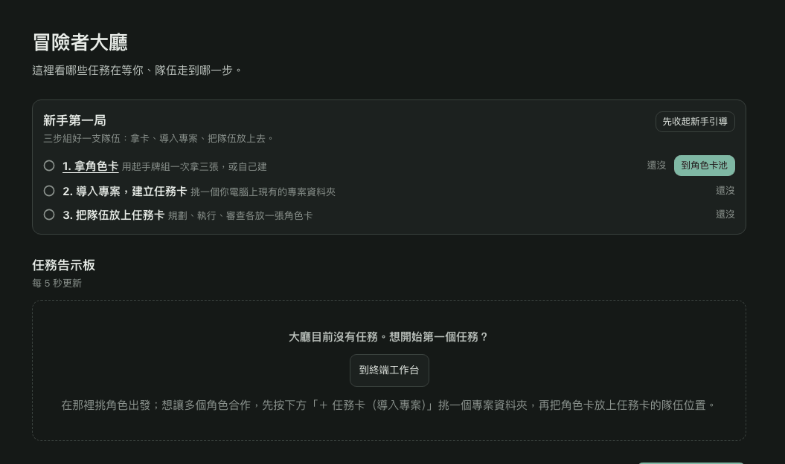
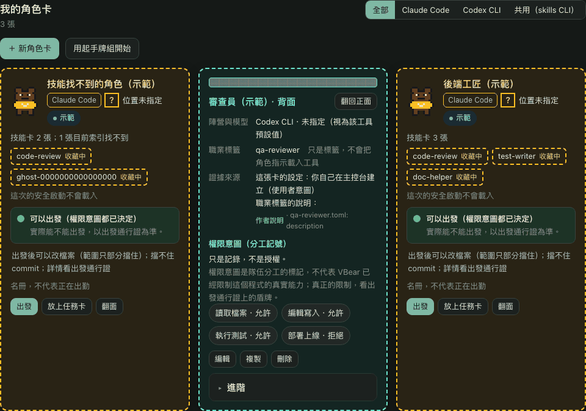
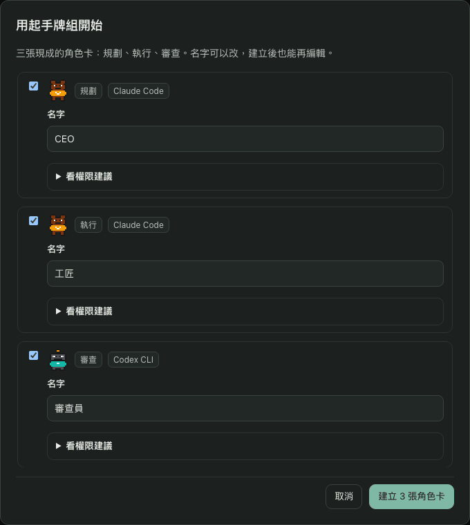
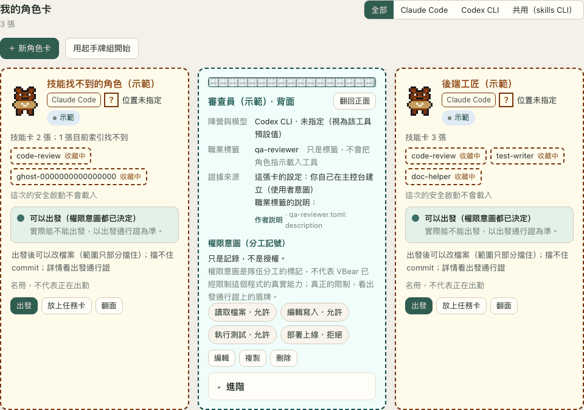
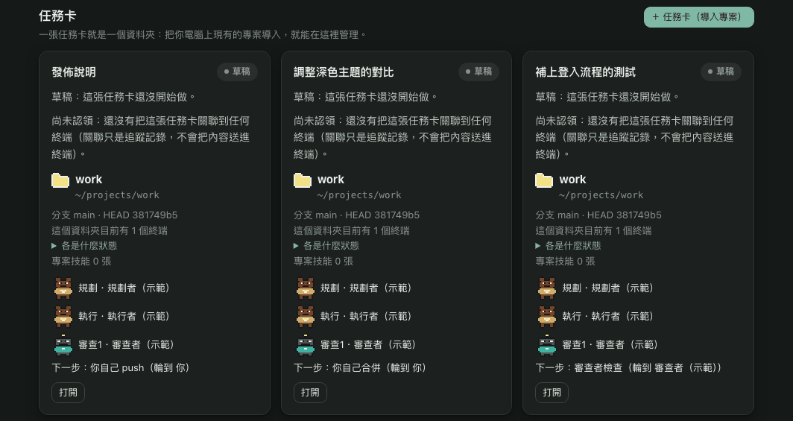
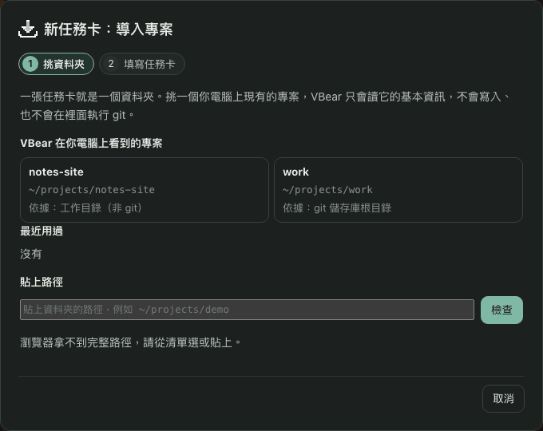
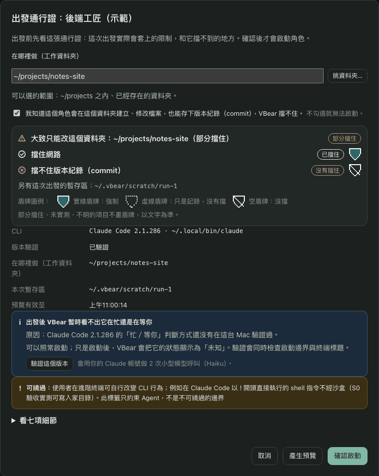
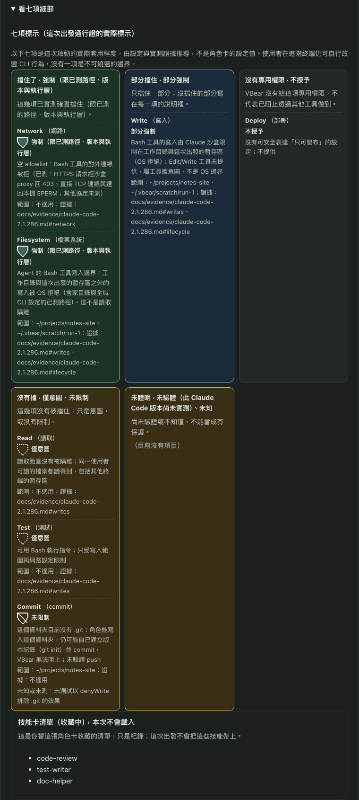
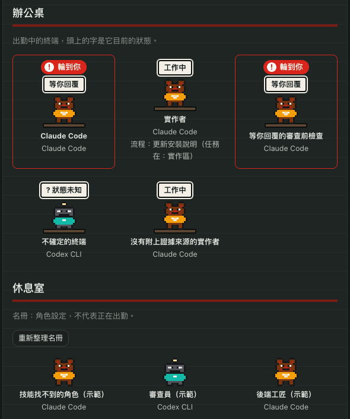

# VBear

**Pick your AI coding agent like a game character: see its class, skills and armor before you send it in.**

VBear is a console that runs on your own Mac. When you start Claude Code from one of its role cards, it shows what
that launch is allowed to do *before* anything starts. It also shows who is working and who is waiting for you,
and where a team of agents stops for your approval. (A terminal tab you open yourself inside VBear is an
ordinary terminal and is not covered by these protections.)

[繁體中文說明](README.zh-TW.md) · [Architecture](docs/ARCHITECTURE.md) · [Security model](docs/SECURITY-MODEL.md) · [Contributing](.github/CONTRIBUTING.md)

> **Status: early (v0.7).** It is built and used daily by one person on macOS.
> The interface is in Traditional Chinese (zh-TW).
> Expect rough edges, and read [Good to know before you start](#good-to-know-before-you-start) before relying on it.

## What is VBear?

Claude Code and Codex can edit files and run commands for you, but it is hard to tell what a launch will really be
allowed to do, or what several agents are up to. VBear puts that on one screen. You choose a character, see its
armor, and only then send it in. If you give a job to a team, VBear shows who is on it and stops at the gates
where you decide.

The game words below are only a way to read VBear's screens. Each one points at something VBear really has.

| In a game | In VBear | Where you see it |
|---|---|---|
| **Character** | A **role card** (角色卡): a saved setup (name, recommended place, tool, skill cards, permission intents) that you can launch. Cards live in the **card pool** (角色卡池) | 角色卡池; the workbench's 「角色」 tab in the right column |
| **Class** | A **role label** (職業標籤) on the card, chosen from the agent roles VBear found for Claude Code or Codex. It is only a label: launching does not load the role's instructions into Claude Code | The card wizard's 「進階」 |
| **Faction** | The **tool** it runs on (陣營): Claude Code or Codex CLI. Launching from a role card works with Claude Code only for now | The card's front |
| **Skill cards** | The **Skills** VBear found: some installed on your Mac, some only a copy on a marketplace that is not installed yet. A card slot is dashed (收藏中: kept in the card, not loaded by a launch) or solid (生效中: only when VBear reports that it loads, which no launch does today) | 技能庫, and the slots on a role card |
| **Launch pass** | The **protection a launch actually puts on, and the weak spots it does not cover** (出發通行證). Three lines on its front, each worded by what was actually verified: where it can write, whether the network is blocked, and always that **commits cannot be blocked**. A shield is solid (enforced), dashed (only a record) or empty (not blocked); partly blocked, untested and unknown items get no shield and are written out in words. The seven permission labels sit behind 「看七項細節」 | 角色卡的「出發」 |
| **Task card** | One **folder** on your Mac (任務卡). Bring an existing project in with 「＋ 任務卡（導入專案）」: VBear reads the folder (read-only: whether it is a git repository, branch and HEAD, project skills, how many terminals are in it) and never writes into it | 冒險者大廳, 流程, the workbench's 「任務卡」 tab |
| **Party** | A **flow**: the planner (who writes the plan), the executor (who does the work) and the reviewers (who check it) on one task card, each with a model family. You put role cards on the **team places** (規劃位, 執行位, 審查位 and an optional second review place); a review place that would not count (same maker as the executor, or a shared card) turns red at once and says why. The planner is a role recorded in the flow: automatic mode runs the plan you approved, and VBear never starts a planner | The task card's team; 流程 |
| **Quest board** | The **home page** (冒險者大廳): what waits for you first (flows at a gate, agents waiting for your reply), then the other tasks in progress; each flow card shows its team and whose turn the next step is. For someone with no team yet, the top shows **the first game** (新手第一局): get role cards, bring in a project, put the team on it, each step ticked from real data. Each card is something VBear already has; nothing is scored | Home page |
| **Office** | A **pixel office** page (辦公室, `#/office`): the flows' teams stand at the **workstation** where their task is (計畫板, 實作區, 審查室, 合併關卡), live terminals sit at **desks** (the words over a character are its state), and the saved role cards stay in the **lounge** (the roster: a role setting, not attendance; it shows at most 24 characters and links to the 「角色卡池」 page for the rest). Click a character for its **weapons** (the tools a launch offers, read from the same constants as the launch's argv), armor and skill cards. A station only says where the task is, never what an agent is doing | 辦公室 |
| **Gates** | **Approval, merge and push gates**: where VBear stops and waits for you | The board's 「輪到你」 and the flow page |
| **Stamina** | The **limits** you set for automatic runs, like a stop-loss: reviews, dispatches, model responses, time, executor budget. When one is reached, VBear stops the flow. Some usage is only known afterwards (cost, for example), so the real figure can end up above a limit; set them low the first time | The approval screen and the executor panel's meters |

Role cards come in three moves: **collect** (take cards from the card pool, or the starter deck of three), **equip** (put skill cards into a card) and **play** (put the card on a task card's team place, then set out). The permission intents on a card are a team-work marker: they do not mean VBear has limited the program's real abilities. The only limits are the ones on the launch pass.

VBear has no levels, hit points or scores. It shows only what it can read or check, and says *unknown* when it
cannot. Putting a skill card into a role card only records your choice. VBear starts Claude Code in its safe mode. By Claude
Code's own help, that switches off skills, CLAUDE.md files, installed plugins, hooks and MCP servers; for skills, a
test on Claude Code 2.1.299 confirmed it. So a launched Claude Code does not use skills for now: a role card's skill
list is a record of your picks.

### What it looks like

All screens below show **demo data**: a synthetic Claude Code and Codex in a temporary folder, not a real project.
Where a picture shows a folder, the temporary folder of the demo run is replaced by a stand-in name such as
`~/projects/notes-site`; your own screens show your real paths.


The **quest board** (demo data), the home page 冒險者大廳. At the top, 「新手第一局」 lists the three steps (take role
cards, bring in a project, put a team on a task card); a step is ticked only from real data, and the demo's own cards
are tagged 示範, so step 1 stays open here. Then 「輪到你」: the flows at a gate and any agent that waits for your reply
(a framed card, with the words that say why), then 「其他進行中的任務」. A card is one flow; the whole card opens it.
Manual flows say that VBear will not move them for you, and nothing is shown that VBear cannot read.



The same page on a **fresh install** (demo data, nothing created yet): the three steps are all open, only the first one
has a button (「到角色卡池」), and the board says there is no task yet instead of showing an empty list.



The **card pool** 「角色卡池」 (demo data). A role card has two faces. The front (left and right here) shows the name,
the tool tag, the position, the skill slots and the one-line light: 「可以出發（權限意圖都已決定）」 followed by
「實際能不能出發，以出發通行證為準」, and a line about what a start allows, written from the same armor items as the pass
(here: files can be changed after a start, with the reach only partly limited, and a commit is not stopped). 「名冊，
不代表正在出勤」 is on every card. The back (middle) holds the faction and model, the role label, where the evidence came
from and the permission intents, each marked as a record and not a grant. The skill slots are dashed 「收藏中」: kept on
the card, and 「這次的安全啟動不會載入」. A solid 「生效中」 slot would appear only if VBear reported that a skill loads,
which no launch does today, so none appears here. A skill that the index cannot find is called out on the card.

<p>


</p>

Left: the **starter deck** 「用起手牌組開始」 (demo data): three ready cards (planner, doer, reviewer) whose names you can
edit; the permission advice behind each is folded. Right: the card pool in the **light theme** (demo data).



**Task cards** (demo data): a task card is one folder. It shows the folder, the branch and HEAD it could read, how many
terminals are in that folder, the team on it (planning, doing and reviewing places) and the next step with who holds it.
A card that no terminal has claimed says so, and says that linking is only a record. (The demo's cards all use the same
folder, so the rows look alike.)



**Bringing in a project** (demo data), 「＋ 任務卡（導入專案）」: pick a folder VBear found on your computer, or paste a
path. The dialog says VBear only reads the folder's basic facts, writes nothing and runs no git in it.


A flow's **progress and team places** (demo data): the gates passed and the current one, the next steps, and the team
on the task card: the planning, doing and reviewing places, each with its model family (the reviewer's place needs a
different family from the doer's), an optional second reviewer, and the card pool below to put a role card on a place.
Saving the team writes a line to the timeline.



The **launch pass** 「出發通行證」 (demo data): the front says in three lines what this start can and cannot do: it can
change roughly this folder (partly limited), the network is blocked, and a commit is not stopped. The acknowledgement that
a commit is not stopped must be ticked before a start. The CLI version, the scratch folder, the 「可繞過」 note and the
folded 「看七項細節」 follow.



What 「看七項細節」 opens (demo data): the seven labels in five groups with each one's evidence, and the chosen skill cards
marked 「本次不會載入」.


A **skill card** (demo data): every field carries where it came from, a field the skill file does not give says so, and
the part 「已插在哪些角色卡上」 shows the skill as 「收藏中（這次出發不會載入）」 on each card that holds it.


The **pixel office** (demo data), `#/office`: teams stand at the station their task is at, a framed team with a red
「輪到你」 badge waits for you, and the panel on the right says what a click shows. The red is used for nothing else.

<p>


</p>

Left (demo data): each live terminal sits at a **desk** with its state in a word box (「工作中」, 「等你回覆」, 「狀態未知」), and the
**lounge** holds the saved role cards. Right: a role card's **panel**: a roster character is not at work and has no live
state; the species choice only changes the roster picture; and the same card is shown with its dashed slots.

Only desk characters with a working status alternate between two typing frames. Teams and roster characters
stay still; the operating system's reduced-motion preference disables the animation. Panels show fixed persona
lines with evidence labels and expandable reasons, plus a collapsible SVG character stage. The monitor uses
words and color for attendance; teams show their task's station and role cards show the roster. The browser saves
the stage collapse preference locally. The characters are original pixel art, inspired by the way
[Pixel-Crew](https://github.com/juinwei7/Pixel-Crew) (MIT) shows an office; no art or code is taken from it.

## What you can do with it

**See what an agent may do before it starts.**
When you launch Claude Code from a role card, you get a launch pass: three lines (where it can write, whether the
network is blocked, and that commits cannot be blocked) worded by what was verified, with the seven permission labels
(read, write, test, commit, deploy, network, filesystem) one click behind them, each with how strongly it holds and the
evidence. A launch starts only after you confirm. If a reason stops it, the pass puts a button next to the reason
(for example 「現在決定」 for an undecided permission intent) and comes back to the same pass with a new preview. The Bash tool can write only to the work directory and a private temporary
folder, and it has no network; where a limit does not hold (reading files, commits), the label says so.

**Keep your skills and roles in one place, and save your picks as role cards.**
VBear reads the skills and agent roles it finds for Claude Code and Codex and shows, for each one, whether
the tool actually loads it, where it came from and what it is for. Every fact carries its source. You can save a
choice of skills and a role as a role card (that records your choice; a launch does not load them). Your own names and notes are
stored locally and never written into the skill files.

**See who is working and who is waiting.**
Agent terminals run in a small background program on your Mac, so they keep running when you close the browser
tab. You can watch any of them, and typing takes an explicit takeover (one tab at a time). For Claude Code that you
launched from a role card, on a version with recorded evidence, the console shows whether it is working or waiting
for you.

**Put several agents on one task and see where it stands.**
A flow records who plans, who does the work and who checks it, and which AI maker each one is from. The 「流程」 page
shows the phase, the review rounds and a timeline, and the home page's quest board lists the gates waiting for you first. A review counts
as a pass only when the checker and the one who did the work are from different makers, so nobody grades their own
work; and a pass is marked out of date as soon as the code changes.

**Let the loop run, and have it stop at the gate.**
Approve a plan once and VBear can hand it to a Claude Code executor, check the executor's report against the
files, ask Codex to review, send NEEDS WORK comments back, and stop at the merge gate. You can stop it at any time and
nothing resumes by itself. It has been run end to end with real models
([evidence](docs/evidence/s3-real-e2e-2026-10-12.md)). It spends your own usage. The limits you set work like a
stop-loss: when one is reached VBear stops the flow, and since some usage is only known afterwards, the real figure
can end up above it, so set them low the first time. VBear never runs `git`: merging and pushing stay with you.

**Everything stays on your Mac.**
No telemetry, no accounts, no cloud. VBear makes no outbound network requests and its server listens on
`127.0.0.1` only. The agents you launch talk to their own providers under your own login, as they would without VBear.

## What VBear promises, in short

- **It holds:** Claude Code that VBear starts can write only inside the work directory, has no network, and changes
  files only through the Bash tool.
- **It does not hold:** reading, because Claude Code can still read any file your Mac account can read, and
  commands you type yourself after `!`, which are not sandboxed.
- **Merging, pushing and publishing are always yours.** VBear never runs `git` for you.
- **Automatic mode uses your accounts' usage.** The limits you set are a stop-loss, not a guarantee of the bill.
- **A review PASS is another AI's opinion, not proof.** Read the changes yourself before you merge.
- **Deleting a flow cannot be undone.**
- **The app is not signed with an Apple Developer ID.** The first time, allow it under System Settings →
  Privacy & Security → **Open Anyway**.
- The full list, with what you can do about each, is in
  [Good to know before you start](#good-to-know-before-you-start).

## Getting started: 3 steps

**Before you set out:** Claude Code is installed on your Mac and you are signed in to it
([get Claude Code](https://claude.com/product/claude-code)). VBear launches it for you, but it does not install it.

1. **Install.** Download `VBear-<version>-arm64.dmg` from the
   [latest release](https://github.com/sidphoto/vbear/releases/latest), open it and drag **VBear** into
   Applications. The first time, macOS refuses to open it: go to **System Settings → Privacy & Security**, scroll
   down and click **Open Anyway** next to VBear. Homebrew and running from source are in [Install](#install).
2. **Open VBear.** The app opens its own window on the quest board, 冒險者大廳. The menu on the left has 冒險者大廳, 辦公室, 終端機, 終端工作台, 流程,
   技能庫, 角色卡池, 專案 and 設定 (on a phone-width window it folds into one menu button that names the page you are on). VBear lists the skills and agent roles it finds on your Mac (read-only; it
   changes none of them). The top of the home page walks you through the first game in three steps.
3. **Collect, bring in a project, and play.**
   - Open **角色卡池** and press **用起手牌組開始** for three ready cards (a planner, an executor and a reviewer), or
     **＋ 新角色卡** for a three-step wizard (name and look, tool and place, skill cards). Pressing **起手牌組** needs
     no typing; the reviewer card is left unticked when Codex is not on this Mac. The three cards carry the one set of
     permission intents VBear can launch today (read, write and test allowed; deploy denied). A Codex card shows a
     neutral "can't open a terminal directly" light: VBear cannot start Codex in a terminal yet, but a Codex card on a
     task card's review place is used by the automatic review.
   - Press **＋ 任務卡（導入專案）** on the home page and pick a project folder from the list of projects VBear saw on your
     Mac, from the recent folders, or paste a path (the app window also has 選擇資料夾…). The check shows whether the
     folder is a git repository, its branch and HEAD, and warns when it is not (a folder without git can still be a
     task card, but a review cannot be tied to a commit there, so it will not count and the merge gate is not
     available). VBear never runs `git init` for you.
   - Put role cards on the task card's team places (click a place and pick from the card pool, drag a card, or press
     **放上任務卡** on a card). Then press **出發** on a card to open its launch pass.
   - Read the three lines on the pass. 「只能改這個資料夾」 and 「擋住網路」 appear only when that limit was really
     verified for this launch; otherwise the line says 部分擋住, 還沒實測 or 不明. The commit line always says
     it cannot be blocked. Behind 「看七項細節」 are the seven labels in five boxes (擋住了 blocked, 部分擋住 partly
     blocked, 沒有專用權限 no dedicated permission, 沒有擋 not blocked, 未證明 not proven), each keeping its own name and the word
     for how strongly it holds, and the list of skill cards you chose, marked as not going with the launch. The words:
     「強制」 and 「部分強制」 mean the limit really holds; 「僅意圖」, 「未限制」, 「未驗證」 and 「未知」 mean it is not
     enforced or not proven; 「不授予」 means it is not given at all. Reading is not limited: it can read any file you can read.
   - Tick the box that says the role will create and change files in this folder and can save commits, which VBear cannot
     block, and press **確認啟動** only if you are happy with what you see.

## Good to know before you start

VBear's rule is to say how far each protection really reaches, and where it does not. Here is where it does not,
and what you can do about each.

- **Files can still be read.** Claude Code launched from a role card can write only inside the work directory and its
  own temporary folder, and it has no network. It can still *read* anything your Mac account can read. Choose the
  work directory with that in mind.
- **Commands you type after `!` are not sandboxed.** In Claude Code, a command you type yourself after `!` runs as
  you, without the sandbox. Type those only when you mean to; the preview says so.
- **Commits cannot be blocked yet.** The work directory's `.git` can be written, so the agent can save commits (a
  commit is a saved snapshot of the code in git) there. You tick a box to acknowledge this before launch; look over
  the history before you merge or push. The launch pass says this on its front, as its own line.
- **Permission intents are a record, not a lock.** The four intents on a role card (read, edit, test, deploy) are
  there to mark the team's division of work. Only one combination can be launched today (read, edit and test allowed,
  deploy denied); a card with another combination shows why it cannot set out. The real limits are the ones on the launch pass.
- **One launch shape for now.** Only Bash is allowed, Edit and Write are off, and there is no network. Read-only,
  network-enabled and Codex launches are planned, not built.
- **Skills are switched off in launches for now.** VBear starts Claude Code with `--safe-mode`, which (as Claude
  Code's own help says) disables skills, CLAUDE.md files, installed plugins, hooks, MCP servers and custom commands
  and agents, and leaves sign-in and model choice as they are. VBear's launch also opens only the Bash tool, so no
  other built-in tool is available in it. A role card's skill list is therefore a
  record of your picks, not something the launch loads or uses. A Claude Code you start yourself in a terminal is
  not launched by VBear and is not affected. Tested on Claude Code 2.1.299 (2026-10-14): in a throwaway project that
  had a project-level skill, a launch with VBear's flags listed none of the user's or the project's skills (a plain
  launch listed them), and its tool list held only Bash, so there is no Skill tool to call even a built-in skill.
- **"Working / waiting" is not known everywhere.** It is shown only for Claude Code launched from a role card, on a
  version with recorded evidence (2.1.291, 2.1.292, or verified on your Mac). After Claude Code updates itself, the
  new version shows *unknown* until you press 「驗證這個版本」 on the launch pass. It cannot tell waiting for your
  next message from waiting on a dialog, and other terminals and Codex show *unknown*.
- **A task card goes out of date only when a commit changes.** Uncommitted changes made after an approval do not
  make it stale, so commit before you approve.
- **Automatic mode runs while you are away.** It spends usage on your accounts. The limits you set work like a
  stop-loss: when one is reached VBear stops the flow. Some usage is only known afterwards (cost, for example), so the
  real figure can end up above a limit, and the limits differ in strength; for the first run, set them low. Review comments, which
  the reviewed code can influence, go to the executor without your approving each one. A turn that was stopped can
  keep running until it ends. After the background program restarts, automatic flows stop and you press 「繼續」:
  VBear first checks the risk acceptance, the limits and the other conditions, and a turn that was cut off is
  counted at its worst case (often the whole budget), so you raise the limit, accept again and approve automatic
  mode again. It was verified end to end with real models on a small toy project (Claude Code 2.1.296 as the
  executor, Codex 0.160.0 as the reviewer; three runs: full loop, stop, console restart): that is evidence it works
  as designed, not a guarantee for your project. Start with low limits, and read the
  [evidence](docs/evidence/s3-real-e2e-2026-10-12.md) and the
  [security model](docs/SECURITY-MODEL.md#phase-3-automatic-mode) before turning it on.
- **A review PASS is not proof.** Letting an agent do the work and Codex review it carries risks you accept once per
  flow (Codex's tools cannot be listed in advance and its multi-agent mode cannot be turned off, only detected; the
  limits differ in strength; settings managed by an organization cannot be seen locally). The same content can get
  different review conclusions, so read the changes yourself before you merge. Deleting a flow cannot be undone;
  a flow whose records are damaged, or cannot be proven to be its own, is refused with the reason, and there is no
  forced delete, so such a flow is cleaned up by hand (see
  [when a flow cannot be deleted](docs/SECURITY-MODEL.md#when-a-flow-cannot-be-deleted)). The full list is in the
  [security model](docs/SECURITY-MODEL.md#phase-2-coordination).
- **Programs running as you can drive VBear.** Other websites and other user accounts are kept out: every request
  needs a token that is renewed at each start and stored in a file only you can read. A program running under your
  account can read that file, so treat VBear like anything else that runs under your account. See the
  [security model](docs/SECURITY-MODEL.md).
- **The app is not signed with an Apple Developer ID**, so macOS refuses to open it the first time. Allow it once
  under System Settings (see [Install](#install)).

## Supported agents

| Agent | Watch and type in terminals | Launch from a role card, with a launch pass and sandbox |
|---|---|---|
| Claude Code | yes | yes. Verified versions (2.1.286, 2.1.291, 2.1.292, 2.1.296, plus any you verify) get enforced labels; other releases launch only after you tick that you know they are **unverified** |
| Codex CLI | yes | **not yet.** The preview explains why: 0.159.2's interactive mode still loads your global config |

The executor (the Claude Code that a flow runs in the background) needs Claude Code 2.1.292 or 2.1.296; Codex review
needs Codex 0.160.0. Other versions are refused with the reason before anything starts.

Skill and role scanning reads Claude Code (`~/.claude`), Codex (`~/.codex`) and shared skills
(`~/.agents`). It never modifies them.

## Install

### The app (recommended)

1. Download `VBear-<version>-arm64.dmg` from the [latest release](https://github.com/sidphoto/vbear/releases/latest),
   open it and drag **VBear** into Applications. It needs an Apple Silicon Mac (M1 or later) and macOS 13 or newer.
   Python is included, so there is nothing else to install.
2. **First open:** the app is not yet signed with an Apple Developer ID, so macOS will refuse to open it the first time.
   Open **System Settings → Privacy & Security**, scroll down, and click **Open Anyway** next to VBear. You only
   need to do this once.

Or with Homebrew:

```sh
brew install --cask sidphoto/tap/vbear
```

The app defaults to window mode. In 「顯示方式」, choose 「在瀏覽器中開啟」 to open the current console in your
default browser, or check 「啟動時用瀏覽器開啟」 to use the browser on future launches. In browser mode the app
exits after opening the console; its background server keeps running. Hold **Option** while launching to open
a window and change the preference. If browser startup fails or takes more than 15 seconds, the app falls back
to a window with an error message.

In window mode, quitting the app stops its window and any server it started. Terminals you opened keep running,
and they are there again the next time you open VBear.

### From source

Requirements:
- macOS. This is the only platform it has been tested on; launching from a role card uses macOS-specific paths.
- Python **3.13 or newer**, because the safe version check for agent CLIs needs `os.waitid`, which
  arrived on macOS in 3.13. The system `/usr/bin/python3` on macOS is 3.9 and will not work, so use
  Homebrew or python.org.
- Claude Code, only if you want launches from role cards. Claude Code updates itself often. A version VBear has not verified
  still launches, but its permission labels say **unverified** and you must tick that you know. The launch dialog's
  **驗證這個版本** button runs the boundary check on it (two small model calls with your own Claude login, about
  1–3 minutes); once it passes, that version counts as verified on your Mac. The same check is
  [`tools/verify_claude_boundary.py`](tools/verify_claude_boundary.py).

There are no packages to install. The backend uses only the Python standard library, and the web UI
has no build step.

```sh
git clone https://github.com/sidphoto/vbear.git
cd vbear
python3 -m vbear launch     # starts the console in the background and opens http://127.0.0.1:7788
```

Other commands:

```sh
python3 -m vbear serve --open   # run in the foreground
python3 -m vbear doctor         # check skill sources and the VBear runtime
python3 -m vbear scan           # rescan skills and print a summary
```

Data lives in `~/.vbear/`. Set `VBEAR_HOME` to use another directory.

## Privacy

- **No telemetry, no accounts, no cloud.** VBear makes no outbound network requests. The server
  binds to `127.0.0.1` only.
- Scanning the agents' own logs extracts only skill names, model names, session IDs, working directories and
  timestamps. Conversation content is never read out or stored. You can turn this off in Settings.
- The agents you launch talk to their own providers under your own login, as they would without VBear.

## The details behind the cards

- **Built-in terminal.** Open your login shell in any folder under your home directory from the
  「終端機」 page and type right away. Multiple terminals show as tabs. These are ordinary terminals
  under your account, **not sandboxed**, and the UI labels them that way.
- **Terminal workbench.** Agent terminals run in a small local background program (the *VBear runtime*), so they keep
  running when the browser tab or the console closes. You can watch any terminal in the browser.
  Typing into it takes an explicit takeover, and only one tab can type at a time.
- **Previewed, sandboxed Claude launches** (launches that VBear starts and keeps watch of). You pick a role card and a work directory, and you
  get a launch pass; behind its three lines are seven permission labels (read, write, test, commit, deploy, network, filesystem).
  Each label says how strongly it is enforced, with the evidence. The launch starts only after you
  confirm it. Claude's Bash tool can write only to the work directory and a private temporary directory
  for that run, and it has no network access. After the run ends, those files are removed only once every
  process of the run is proven gone.
- **Skill and role library.** It reads the skills and agent roles installed for Claude Code and Codex.
  For each one it shows whether the tool actually loads it, where it came from, and what it is
  for. Every fact carries its source, and it says *unknown* when there is no source.
- **Projects and team view.** It groups running terminals by git repository and by agent role. It also
  shows which model and which skills a run actually used, read from the agent's own session logs.
- **Working or waiting.** For Claude Code launched from a role card, on a version with recorded evidence
  (2.1.291 and 2.1.292 built in, plus any version whose title check passed on your Mac), the console shows whether
  the agent is working or waiting for you, read from the terminal title Claude sets, and lists the waiting ones on
  the home page. Every status says what it is based on; anything else shows *unknown*. 「驗證這個版本」 in the
  launch dialog checks the title in the same run as the launch boundary.
- **Task cards.** Local goal, scope and acceptance checklists. The status shows separately what an agent claimed,
  what tests reported and what you approved, and the console never labels a card "verified". With a work
  directory, a test result and an approval are tied to the commit they were given for and go stale when it moves.
  Marking a card done or blocked asks what follows; a handoff closes the card and opens its successor with the
  chain of earlier cards; whether anyone is on it is worked out from the linked terminal, not typed in.
- **Flows (look-only).** One task card carried by several agents: who plans, who executes, who reviews, each
  with a model family (the maker of the model: Anthropic, OpenAI, Google and so on). The 「流程」 page shows the phase (planning, awaiting approval, implementing, review round N,
  needs fix, passed and awaiting merge, review out of date, awaiting push, done), the review rounds and a timeline,
  and the home page's board lists the gates waiting for you first. Phases are derived on every read, never stored, from the events (the ones the runner writes in automatic
  mode included) and the live view. A review
  counts as a pass only when reviewer and executor are of different, known model families, and a pass goes out of
  date as soon as the executor's directory moves off the reviewed commit. The events you enter by hand are
  labelled 「手動記錄（未驗證）」. The board's recording routes do not dispatch work, type into a terminal, run `git`
  or start an agent (the executor below is separate). Like the home page, the flows pages read the live
  view, which can start VBear's own runtime.
- **Executor and review (Phase 2).** From a flow you can start a Claude Code executor that VBear runs in
  the background (no terminal) and ask Codex to review its latest commit in a separate sandboxed clone. You accept
  three residual risks per flow, approve each dispatch as the exact text that will be sent, see the executor's own
  report apart from VBear's file checks, read the reviewer's report as plain text, and get the merge and push
  commands to run yourself: VBear never runs `git` for you. Needs Claude Code 2.1.292 or 2.1.296 and Codex 0.160.0 (the
  verified versions) and costs usage on your own accounts. Data stays until you delete the flow. See the
  [security model](docs/SECURITY-MODEL.md#phase-2-coordination) before using it.
- **Automatic mode (Phase 3).** After you approve a plan, VBear can run the loop itself: dispatch the plan, check
  the executor's report against the files, ask Codex to review, forward NEEDS WORK comments back (as marked data),
  and stop at the merge gate for you. The approval shows the whole plan, the limits, the accounts and every risk
  at once; you can stop it at any time; nothing resumes by itself; a restart stops every automatic flow. VBear
  still never runs `git` for you. It has been verified end to end with the real models (Claude Code 2.1.296 and
  Codex 0.160.0: a full run to the merge gate, a stop while a review runs, and a console restart while a review runs;
  see the [evidence](docs/evidence/s3-real-e2e-2026-10-12.md)). After the background program restarts, every
  automatic flow is stopped and runs again only when you press 「繼續」. VBear first checks that your risk acceptance
  still counts and that HEAD, the reviews and the limits allow it. A turn that was cut off is charged at its worst
  case (often the session's whole budget): then you raise the limit, accept again and approve automatic mode again.
- **Names on the screens.** Some names changed to match the game words above (old → new): 「Agent 團隊」 →
  「角色卡池」; 「Agent Profile」/「Profile」 → 「角色卡」 (the 「建立 Agent Profile」 button is 「＋ 新角色卡」); 「已選技能」 →
  「技能卡」 (「收藏中」 or 「生效中」); 「工具（遊戲用語：陣營）」 → 「陣營」; 「Permission Intents」 → 「權限意圖」
  (讀取檔案, 編輯寫入, 執行測試, 部署上線; 允許, 拒絕, 還沒決定); 「出發前檢查」 → 「出發通行證」; the pass's 「防具」
  heading → 「七項標示」 (「防具」 stays the name of the group on a card's back); a task card with an optional work directory →
  「任務卡」 that is one folder; a flow's planner/executor/reviewers → 「規劃位, 執行位, 審查位」; the red text
  about what is missing → a 「下一步」 list that says whose turn each step is. Earlier changes: 「角色裝備」 tab → 「角色」;
  「職業角色」 → 「職業」 (now 「職業標籤」); 「預覽並啟動」 → 「出發前檢查」 → 「出發通行證」; the limits' heading
  「上限」 → 「體力（停損設定）」; a flow's 「階段」 → 「任務進度」 and its 「角色」 section → 「隊伍」.
- **Your own notes.** Give skills friendly names, tags and notes. These are stored locally and never
  written into the skill files.

## Technical details

- **Standard library only.** The backend uses only the Python 3.13+ standard library (no pip packages, no cloud
  services). The web UI has no build step. Its one dependency is the MIT-licensed `@xterm/xterm` and
  `@xterm/addon-fit`, bundled in `web/vendor/xterm/` at a pinned version and checked against fixed SHA-256 hashes by
  the tests. Nothing is loaded from a CDN, and the content security policy keeps `script-src 'self'`.
- **Read-only sources.** VBear reads only the external sources you select and changes no skill or role file. It
  runs no script found in a skill. (VBear's own settings, notes and terminal actions are the exceptions.)
- **Sourced facts.** Every fact is labelled with where it came from (the author's description, derived by VBear,
  observed at run time, or not provided), and *unknown* is shown when there is no source.
- **Where things are.** How it is built is in [ARCHITECTURE](docs/ARCHITECTURE.md); what it defends against and
  what it cannot is in the [security model](docs/SECURITY-MODEL.md).
- **Reference sections only in Traditional Chinese.** The page-by-page tour, where each fact comes from, the skill
  states, the security details, the state directory and the source layout are currently written out only in
  [docs/REFERENCE.zh-TW.md](docs/REFERENCE.zh-TW.md). For the English side, see
  [ARCHITECTURE](docs/ARCHITECTURE.md) and the [security model](docs/SECURITY-MODEL.md).

## Developing

```sh
python3 -m unittest discover -s tests              # backend tests (synthetic HOME, no network)
for f in tests/frontend/*.cjs; do node "$f"; done   # frontend behaviour tests (Node, synthetic DOM)
```

See [CONTRIBUTING](.github/CONTRIBUTING.md) for the workflow and [AGENTS.md](AGENTS.md) for
instructions aimed at coding agents working on this repository.

## Community & support

- Questions and ideas: [GitHub Discussions](https://github.com/sidphoto/vbear/discussions)
- Bugs and feature requests: [GitHub Issues](https://github.com/sidphoto/vbear/issues)
- Security issues: please **do not** open a public issue. See [SECURITY.md](SECURITY.md).

Issues and discussions in English or Traditional Chinese are both welcome.

## License

[MIT](LICENSE). The bundled [xterm.js](https://github.com/xtermjs/xterm.js) and its fit addon
(`web/vendor/xterm/`) are MIT-licensed by their authors; see `web/vendor/xterm/LICENSE`.

## About

VBear is named after the Formosan black bear and the V-shaped mark on its chest. Like the bear,
it watches before it acts: VBear shows you what a launch may do before anything starts.

It was called **SID Console** until v0.1.0, and it began as a plugin for the Herdr terminal multiplexer.
The last Herdr-based version is tagged `last-herdr`. On first start, VBear moves an existing
`~/.sid-console` state directory to `~/.vbear`.

### Skill descriptions in Traditional Chinese (candidate)

The Skills Library, Armory skill cards and workbench skill dialogs can display separately labelled machine
translations with “what / when / needs” summaries, an author-original toggle and visible stale warnings when
author fields change. Chinese translations participate in library search. Missing author information stays
“not provided”; generated content is not a verified capability. Skill files are never modified.

Single/batch translation asks before sending redacted author fields through your logged-in local CLI and
using its quota or paid usage. Settings defaults to Claude Haiku; Codex is selectable. Automatic retranslation
is off by default, requires engine-specific disclosure/consent, and queues up to 20 missing/stale entries after
an explicit console rescan. A global progress strip survives navigation/refresh and allows cancellation; a finished job
folds away after 5 seconds, a failed one after 10 seconds into a small dot at the lower right that reopens the reason,
and every state has a close button. A failure is also written on the skill card the job was started from, with a retry.
The confirmation says in one sentence that it uses your own account and usually costs under one US cent per card; the
whole budget and timeout text stays behind 「詳細」.
Changing engines disables automation until consent is renewed; clearing orphan cache entries requires two
confirmations. Claude's requested US$0.05 per-item budget is not a guaranteed invoice cap. Codex cost and
all token estimates are unknown.

**Real translation execution is currently blocked.** The exact no-tools CLI boundary has no version-specific
evidence yet; existing agent-launch evidence includes Bash and cannot be reused. Both production providers
fail closed before spawning a CLI. The UI, cache, worker and API are a reviewable candidate; enabling real
execution needs separately authorized CLI verification and a reviewed provider change. No real CLI/model was
called for this feature's tests. Existing agent launch and dispatch behaviour is unchanged.

AGY can exercise both engine choices with a synthetic HOME, temporary state, random console port and fake
translation CLI:

```sh
VBEAR_QA_TRANSLATE=1 VBEAR_QA_SERVE=1 python3 -m unittest tests.qa_game_ui.Serve -v
```

Use only the login URL and synthetic paths printed by that harness. It seeds fresh/stale/missing/orphan
states and prints the browser checklist. `python3 -m unittest tests.qa_game_ui.TranslationCheck -v` checks
both fake providers, source-change detection and cache cleanup without a real account. The complete Python
suite and real browser QA remain independent acceptance work, not evidence supplied by these fixtures.
