# VBear

<picture>
  <source media="(prefers-color-scheme: dark)" srcset="docs/images/banner-dark.png">
  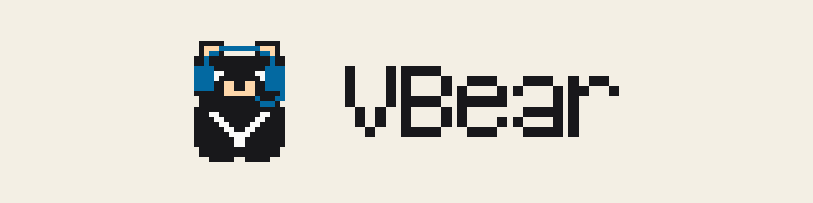
</picture>

**像選遊戲角色一樣挑選你的 AI 寫程式助手：出發前，先看清楚它的職業、技能和出發通行證。**

VBear 是跑在你自己 Mac 上的主控台。你用它的角色卡啟動 Claude Code 時，它會在啟動「之前」先告訴你這次允許做什麼；
它也讓你看到誰在工作、誰在等你，以及多個 Agent 合作時會在哪些關卡停下來等你核准。（你在 VBear 裡自己開的終端機分頁，
是一般的終端機，不在這些保護裡。）

[English](README.md) · [架構](docs/ARCHITECTURE.md) · [安全模型](docs/SECURITY-MODEL.md) · [參與貢獻](.github/CONTRIBUTING.md) · [回報資安問題](SECURITY.md)

> **目前狀態：早期版本（v0.9）**，只在 macOS 上由作者本人日常使用與測試。畫面是繁體中文。
> 開始使用前請先看下方「使用前要知道的事」。

## VBear 是什麼？

Claude Code 和 Codex 可以替你改檔案、跑指令，但你很難知道一次啟動實際上被允許做什麼，也不容易看出好幾個 Agent
合作時各自在做什麼。VBear 把這些放在同一個畫面：你先選好角色、看過它的防具，才讓它出發；如果把一件工作交給一個隊伍，
VBear 會顯示誰負責什麼，並在需要你決定的關卡停下來。

下面的遊戲用語只是幫你讀懂 VBear 的畫面，每一項都對應 VBear 真的有的功能。

| 遊戲裡 | 在 VBear 裡 | 在哪裡看 |
|---|---|---|
| **角色** | **角色卡**：一組存起來、隨時能啟動的設定（名稱、建議位置、職位指示、出發方式、工具、技能卡、權限意圖）。所有角色卡放在**角色卡池** | 角色卡池；終端工作台右欄的「角色」分頁 |
| **職業** | 角色卡上的**角色範本**（選填），從 VBear 找到的 Claude Code／Codex Agent 角色中選取（VBear 沒有掃描 Antigravity 的 Agent 角色，AGY 卡沒有職業可選）。挑選器只列這張卡的陣營用得到的範本，依「它大概屬於哪個位置」分組（依名稱推測，會標明是推測），可以搜尋；翻成中文後，每個職業都同時顯示中文與英文名稱。選了之後可以一鍵套用範本寫明的建議位置、技能卡與模型。它只是標籤：啟動時不會把角色的指示載入工具 | 建立角色卡精靈的第 2 步，在「建議位置」下面 |
| **建議位置** | 角色卡上的**建議位置**，照一人公司的分工分兩排。任務卡上的職位：CEO（執行長）、全端工程師、社群媒體經理、藝術總監；幕僚：PM（專案經理）、法務經理、會計師；也可以先不指定。獨立審查不是公司職位，是 VBear 內建的審查關卡，另外列一個選項，給任務卡的審查位用。選了之後會看到它負責什麼、放上任務卡時建議放哪（審查關卡建議放審查位或第二位審查，要和執行位不同陣營）、建議用哪個陣營與模型（藝術總監建議用 AGY，VBear 不會幫 AGY 出發，只做紀錄）、一句分工提醒。以前本機版本留下的舊位置會對應成現在的職位並標「舊位置」。它只是標籤：每個位置建議的權限意圖都一樣（目前 VBear 只能讓同一組權限出發），分工提醒要你自己寫進任務卡的目標，VBear 擋不住。位置存在角色卡裡，換瀏覽器或換埠號打開也看得到（以前只記在瀏覽器裡的，在精靈按儲存後才寫進卡片）；幕僚卡通常不上任務卡，需要時單獨出發 | 建立角色卡精靈的第 2 步；任務卡的隊伍位置 |
| **指令** | 角色卡上的**職位指示**：寫給 AI 的話，從職位的預設開始（最多 2000 字，「回復預設」可以改回預設）。完整模式的 Claude Code 卡出發時，會把它當成一個 `--append-system-prompt` 引數帶進去，出發通行證顯示全文（VBear 沒有驗證 Claude Code 實際收到）；其他情況要在接管終端之後按「貼上職位指示」貼進輸入框，由你自己按 Enter，VBear 不會替你按。開會時每位發言者的呼叫都會帶上它；執行位那張卡的指示會放在自動執行計畫的最前面。精靈在指示下面列出這個職位的邊界，逐條標明「擋得住」（安全模式出發時，限已驗證的版本）「只是提醒」「做不到」或「不適用」 | 建立角色卡精靈的第 2 步；角色卡背面；終端的「貼上職位指示」 |
| **戰鬥風格** | 角色卡的**出發方式**。完整模式（新卡的預設）像你自己在終端機啟動工具一樣：用你自己的設定、技能、`CLAUDE.md`、MCP 伺服器、外掛，也可以上網，VBear 不加任何限制。安全模式是有沙盒、有出發通行證盾牌的那種出發。v0.9.0 以前存的卡沒有 `launch_mode`，一律是安全模式 | 建立角色卡精靈的第 2 步；出發通行證 |
| **陣營／種族** | 它用的**工具**（陣營）：Claude Code、Codex CLI 或 Antigravity（AGY）。完整模式下，三種卡都能從角色卡出發；安全模式只有 Claude Code 卡能出發（VBear 還沒辦法替 Codex 加沙盒，Antigravity 沒有安全模式的出發，這時卡片只用來排隊伍與記錄）。AGY 卡的模型家族一律算 Google；AGY 卡能收藏「AGY 在這台電腦上會讀」的技能（依 AGY 自己的設定判斷，見下方說明），而且只是收藏；其他技能卡會灰掉，寫著「AGY 不會讀這張技能卡」 | 角色卡正面 |
| **技能卡** | VBear 找到的 **Skill**：有的已經裝在你的 Mac 上，有的只是市集上還沒安裝的副本。插在角色卡上的插槽是虛線（收藏中：存在卡上，啟動時不載入）或實線（生效中：只有 VBear 回報真的會載入才用，目前沒有任何一種啟動會；完整模式的出發會載入你自己的設定所載入的技能，VBear 不會逐卡追蹤） | 技能庫，以及角色卡上的插槽 |
| **出發通行證** | 這次啟動**實際穿上的保護，以及它擋不到的地方**。正面三行，各依實測結果寫：寫入範圍、網路有沒有擋，以及固定一行「**擋不住版本紀錄（commit）**」。盾牌實線＝強制、虛線＝只是記錄、空＝沒擋；部分擋住、未實測、不明的項目不畫盾牌，只用文字說明。七項權限標示收在「看七項細節」裡。完整模式的卡不畫盾牌：通行證開頭寫「VBear 沒有限制這張卡」，並列出要執行的指令 | 角色卡的「出發」 |
| **任務卡** | 你電腦上的**一個資料夾**。按「＋ 任務卡（導入專案）」把現有的專案導入：VBear 唯讀地檢查資料夾（是不是 git 儲存庫、分支與 HEAD、專案技能數、資料夾裡有幾個終端），不會寫進你的資料夾 | 冒險者大廳、流程、工作台的「任務卡」分頁 |
| **隊伍** | **流程**：同一張任務卡的規劃者（寫計畫的人）、執行者（動手做的人）與審查者（檢查的人），各自標明模型家族。你把角色卡放上任務卡的**隊伍位置**（規劃位、執行位、審查位，另有選填的第二位審查）；審查位若不算數（和執行位同一家，或是共用陣營的卡），立刻變紅並寫明原因；AGY 卡算 Google 家，所以放在 Claude Code 或 Codex 執行位旁邊的審查位算獨立，放在 Google 執行位旁邊則不算。規劃者只是流程裡記錄的角色：自動模式執行的是你核准的計畫，VBear 不會去啟動規劃者 | 任務卡上的隊伍；流程 |
| **任務告示板** | **首頁**（冒險者大廳）：先列出輪到你的（停在關卡的流程、等你回覆的 Agent），再列其他進行中的任務；流程卡上有隊伍小頭像和「下一步輪到誰」。還沒有隊伍的新手，最上方有**新手第一局**：拿角色卡、導入專案、把隊伍放上任務卡，每一步依真實資料打勾。每張卡都是 VBear 已經有的資料，不打分數 | 首頁 |
| **辦公室** | **像素辦公室**頁（`#/office`）：流程的隊伍站在任務目前所在的**工作站**（計畫板、實作區、審查室、合併關卡），出勤中的終端坐在**辦公桌**（角色頭上的字就是它的狀態），存好的角色卡待在**休息室**（名冊：角色設定，不代表正在出勤；最多顯示 24 個，超過時連到「角色卡池」頁看其餘的）。點角色看它的**武器**（啟動會開放的工具，讀自和啟動參數同一組常數）、防具與技能卡。站只表示任務在哪裡，不表示 Agent 正在做什麼。**會議室**顯示最新一場進行中或等你核准的會議，角色頭上的字只取自會議紀錄；**董事長桌**寫著幾場會議等你核准，附「去核准」；進行中或等你看的組隊會議也坐在會議室（標「組隊會議」），董事長桌另外寫幾份「組隊提案待你看」，附「去看提案」 | 辦公室 |
| **關卡** | **核准、合併、push 關卡**：VBear 在這裡停下來等你 | 告示板的「輪到你」與流程頁 |
| **會議** | **會議**（`#/meetings`）：各職位用文字討論一個議題，每位各發言一次、彼此看不到對方的發言，再由 CEO 卡做決定。你是董事長：重大的事會等你（輪到你：董事長核准）。每次發言都是一次完全沒有工具的 Claude Code 呼叫；其他工具的卡由 Claude 代發言。會議求快：發言者的思考強度是低、CEO 是中，一場預設最多 15 分鐘，最後 3 分鐘留給 CEO。決定只是紀錄 | 會議頁；任務卡上的「開會討論」；辦公室的會議室與董事長桌；告示板的「輪到你」 |
| **組隊會議** | **組隊會議**（`#/staffing`）：針對一張任務卡，各職位各自說一次需要誰、需要哪些技能，再由 CEO 卡寫出組隊提案（四個位置各放誰、開會時找哪些幕僚、要新建哪些卡、每張卡插哪些技能、還缺哪些技能）。你先把提案改成草稿，再用「照草稿採用」照固定順序一步一個按鈕採用（啟用、建新卡、插技能、帶到隊伍、帶去開會、記下）。VBear 不會自己建卡、插技能或存隊伍 | 任務卡上的「請 CEO 組隊」；辦公室的會議室與董事長桌；告示板的「輪到你」 |
| **體力** | 自動執行時你設定的**各項上限**：審查次數、派工則數、模型回應數、時間、執行者額度。把它當成「停損設定」：上限一到，VBear 就停下流程。有些用量要事後才知道（例如花費），所以實際可能比上限多；第一次用，建議把上限設低 | 核准畫面與執行者面板的用量表 |

角色卡的玩法是三個動作：**收集**（從角色卡池拿卡，或用三張一組的起手牌組）、**裝備**（把技能卡插進角色卡）、**出牌**（把角色卡
放上任務卡的隊伍位置，然後出發）。角色卡上的權限意圖是隊伍分工的標記，不代表 VBear 已經限制這個程式的真實能力；真正的限制只看出發通行證。

VBear 沒有等級、血量或分數。它只顯示讀得到、查得到的事，查不到就寫「未知」。把技能卡插進角色卡只是
記下你的選擇。安全模式出發時，VBear 用 `--safe-mode` 啟動 Claude Code；依 Claude Code 自己的說明，這會關掉技能、CLAUDE.md、
已安裝的外掛、hooks 與 MCP 伺服器；技能這一項已在 Claude Code 2.1.299 實測確認。所以安全模式出發的 Claude Code 不會
使用技能：角色卡的技能欄只是你的挑選紀錄。完整模式出發會載入你自己的設定所載入的東西，不管卡上選了什麼，VBear 也不追蹤載入了哪些。

### 畫面長這樣

以下所有畫面都是**示範資料**：在暫存資料夾裡跑的合成 Claude Code 與 Codex，不是真實專案。圖中出現資料夾或程式路徑的地方，示範用的暫存路徑已換成
示意名稱（例如 `~/projects/notes-site`）；你自己的畫面會顯示真實路徑。多數圖是淺色主題，有兩張是深色主題，兩個主題顯示的內容相同。


**任務告示板**（示範資料），也就是首頁「冒險者大廳」。最上面的「新手第一局」列出三步（拿角色卡、導入專案、把隊伍放上任務卡）；
每一步只依真實資料打勾，示範用的角色卡標著「示範」，所以第 1 步在這裡仍是未完成。接著是「輪到你」：停在關卡的流程與等你回覆的
Agent（外框加粗，並用文字寫明原因），再來是「其他進行中的任務」。一張卡是一個流程，整張卡都能點進去。兩張卡同名時，會多一行小字寫上資料夾與建立的日期。
手動模式的流程會寫明 VBear 不會替你推進；讀不到的東西不會顯示。


同一頁在**剛安裝時**的樣子（示範資料，還沒建立任何東西）：三步都未完成，只有第一步有按鈕（「到角色卡池」），告示板直接寫
「大廳目前沒有任務」，不會顯示空清單。


**角色卡池**（示範資料）。一張角色卡有正反兩面，外框用陣營的顏色（Claude Code 偏暖色、Codex 偏青綠色、Antigravity 偏天藍色）。正面（左右兩張）有名字、
工具標籤、位置、技能插槽，以及一行燈號「可以出發（權限意圖都已決定）」加上「實際能不能出發，以出發通行證為準」，還有一行說明這次啟動能做什麼，
內容與出發通行證用的是同一份防具項目（這裡是：出發後可以改檔案，範圍只部分擋住，commit 擋不住）。每張卡都寫著「名冊，不代表正在出勤」。
背面（中間）是陣營與模型、職業標籤、證據來源與權限意圖，每項都標明只是記錄，不是授權。技能卡是一個切掉一角的晶片；放在插槽裡是虛線的
「收藏中」：存在卡上，「這次的安全啟動不會載入」。實線的「生效中」只有在 VBear 回報某個技能真的會載入時才會出現，目前沒有任何一種啟動會，所以這裡
沒有實線。索引找不到的技能會在卡上點出來。（這張圖是 v0.8 拍的；v0.9.0 的卡背還會寫出這張卡的出發方式，以及職位指示會帶到哪裡。）

<p>

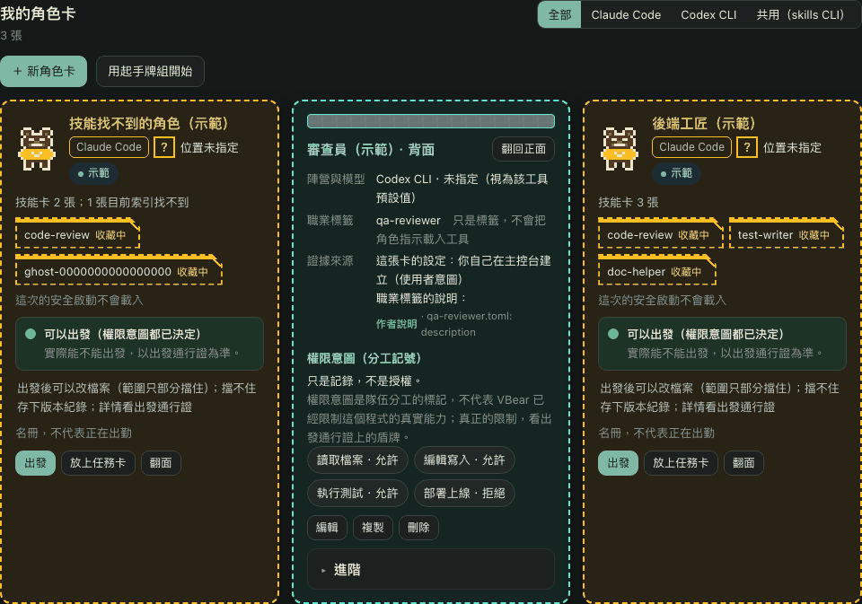
</p>

左：**起手牌組**「用起手牌組開始」（示範資料）：CEO、全端工程師，以及給審查關卡的審查員三張現成的卡，各帶自己位置的徽章（長、工、審），
名字可以改，每張背後的權限建議收合在「看權限建議」裡；這三張都是安全模式的卡。右：**深色主題**的角色卡池（示範資料）。

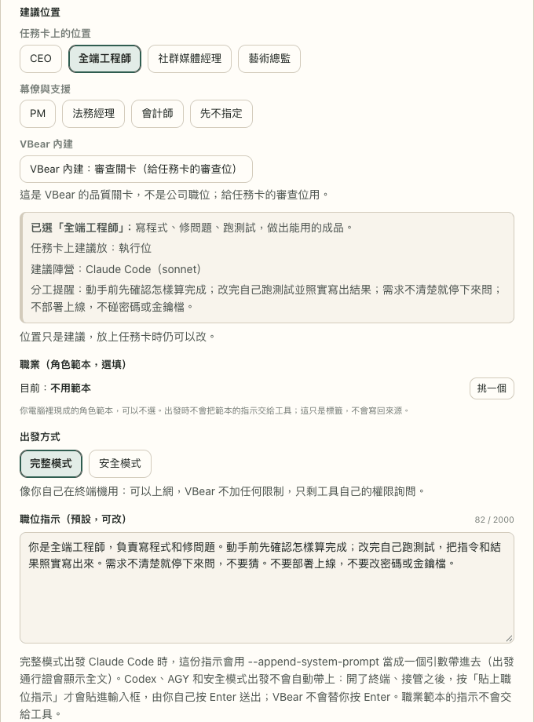

**角色卡精靈第 2 步**（示範資料；視窗本身會捲動，這裡把從「建議位置」到職位指示的這一段攤開顯示）：任務卡上的位置（CEO、全端工程師、社群媒體經理、
藝術總監）、幕僚與支援（PM、法務經理、會計師）加上「先不指定」，審查關卡另外列出：「VBear 內建：審查關卡（給任務卡的審查位）」。選中的職位會寫出它做什麼、
在任務卡上建議放哪一位、適合的陣營與模型，以及一行分工提醒。下面是職業、出發方式（這裡選了完整模式：「像你自己在終端機用：可以上網，VBear 不加任何限制，
只剩工具自己的權限詢問。」）和職位指示：一開始是這個職位的預設內容並顯示字數（改過之後才會出現「回復預設」），下面一行寫明指示會帶到哪裡。
再往下是邊界與權限意圖。


**任務卡**（示範資料）：一張任務卡就是一個資料夾。卡頭寫著卡名、流程目前到哪裡，還有規劃、執行、審查三格小燈（規、執、審）。小燈只依流程真實的階段亮，
沒有流程就什麼都不說；「已過」是排在順序裡的位置，不代表有人核准過。下面是資料夾、讀得到的分支與 HEAD、這個資料夾目前有幾個終端、放在上面的隊伍，
以及下一步輪到誰。還沒有人標成「執行中」的卡叫「草稿」，並用一行寫明：這只是標記；「這是什麼」會展開較長的說明。還沒有終端認領的卡也會直接寫明，
並說明關聯只是追蹤記錄。（示範的任務卡都用同一個資料夾，所以每張看起來很像。）


**導入專案**（示範資料，「＋ 任務卡（導入專案）」）：從 VBear 在你電腦上看到的資料夾挑一個，或貼上路徑。視窗寫明 VBear 只會讀資料夾的
基本資訊，不會寫入，也不會在裡面執行 git。


流程的**任務進度與隊伍位置**（示範資料）：走過的關卡與目前所在的關卡、接下來的步驟，以及任務卡上的隊伍：規劃位、執行位、審查位，
每個位置都寫著適合哪些職位（適合：…）和模型家族（審查位要和執行位不同陣營）；位置上放了東西之後，會套用它的陣營色與這個位置的徽章（長、工、審）。
這裡的三位是手動填寫的，所以各自寫著沒有對應的角色卡。空位維持素色。
另有選填的第二位審查；下方的角色卡池是一排小卡（名字、工具與你替它存的位置，「？」代表沒存），可以放上位置。儲存隊伍會在時間軸記一筆。

<p>
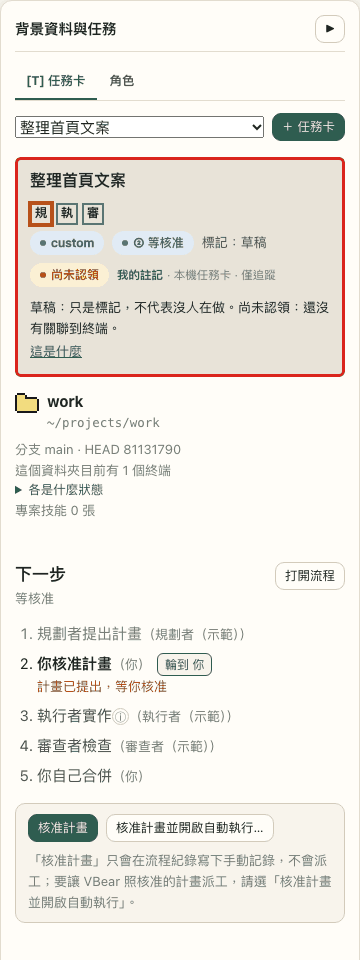
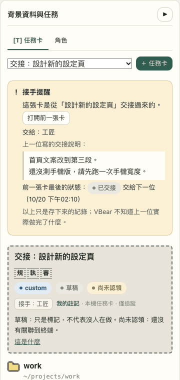
</p>

左（示範資料）：**終端工作台**裡的任務卡。卡頭顯示流程目前的關卡（這裡是「等核准」），原本的標記縮成小字「標記：草稿」。輪到你時，
「下一步」方塊直接放按鈕：「核准計畫」只在流程記一筆手動記錄（不會派工）；「核准計畫並開啟自動執行…」打開和原本相同的核准視窗，裡面有完整的計畫、
上限與風險。右（示範資料）：從**交接**建立的任務卡，最上方有「接手提醒」：從哪張卡交接過來（可以按開）、交給誰、
上一位寫的交接說明原文，以及前一張卡最後存下的狀態。VBear 只顯示存下來的資料，並說明它不知道上一位實際做完了什麼。

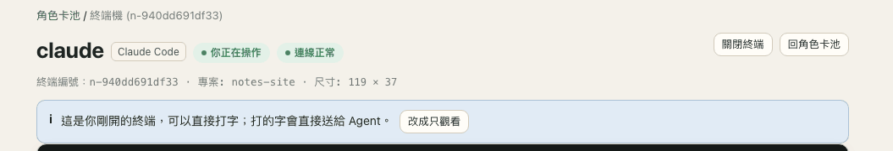

**這個分頁剛開出來的終端**（從出發通行證或任務卡按「確認啟動」；示範資料，示範用的合成 Agent 沒有輸出，所以只放頁面上方）：可以直接打字，
並有一行寫明：「這是你剛開的終端，可以直接打字；打的字會直接送給 Agent」，旁邊的「改成只觀看」把鍵盤還回去。只有按下「確認啟動」的那個分頁，
在兩分鐘內才會這樣；重新整理、從網址或別的分頁打開同一個終端，都是只能觀看。從任務卡出發時，工作台會把新終端開在那張卡旁邊，
而且在你沒改掉卡片資料夾的情況下，把終端記到任務卡上（只是追蹤記錄，不會送任何東西進終端）。

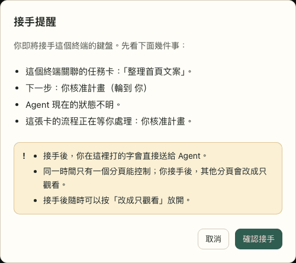

**接管一個已經在跑的終端**（示範資料）會先出現「接手提醒」：這個終端關聯的任務卡與它的下一步（沒有關聯就寫「這個終端沒有關聯任務卡」）、
VBear 讀得到的 Agent 狀態（這裡是「不明」；正在工作的會加一句「現在打字可能打斷它」），以及這張卡的流程是不是在等你。接著是三行固定提醒：
你打的字會直接送給 Agent、同一時間只有一個分頁能控制、隨時可以改成只觀看。焦點一開始在「取消」，所以按一下 Enter 不會接手。


**出發通行證**（示範資料）：正面用三行說明這次出發能做什麼、擋不住什麼：大致只能改這個資料夾（部分擋住，不畫盾牌）、網路已擋住（實心盾牌）、commit
沒有擋住（畫斜線的空盾牌）。虛線盾牌代表只是記錄。圖例在三行下面；部分擋住、未實測、不明的項目不畫盾牌，只用文字說。
出發前必須勾選「commit 擋不住」的知悉，勾選時預覽也會自動產生。下面是 CLI 版本、暫存區、「可繞過」說明，以及收合的「看七項細節」。


「看七項細節」展開後（示範資料）：七項標示分成五組，各附證據，有盾牌的項目畫出盾牌；已選的技能卡標明「本次不會載入」。

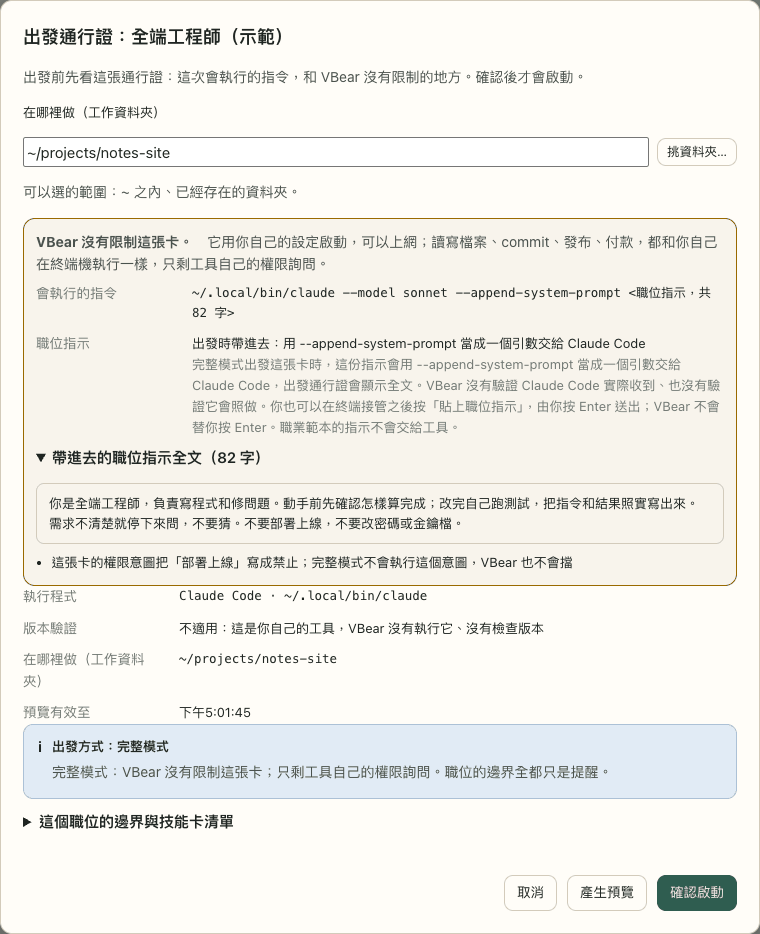

**完整模式角色卡**的出發通行證（示範資料；程式路徑與資料夾是示意名稱）：開頭寫「VBear 沒有限制這張卡」，列出實際要執行的指令
（`claude --model sonnet --append-system-prompt …`）和它帶進去的職位指示全文，點出不會被執行的權限意圖（禁止部署上線），寫明 VBear 沒有執行這個工具、
也沒有檢查它的版本，而且不畫盾牌。這裡沒有要勾選的知悉；一樣要按「確認啟動」才會出發。


**技能卡**（示範資料）：每個欄位都標明來源，技能檔沒寫的欄位會直接說沒寫，「已插在哪些角色卡上」會把這個技能在每張卡上的狀態寫成
「收藏中（這次出發不會載入）」。

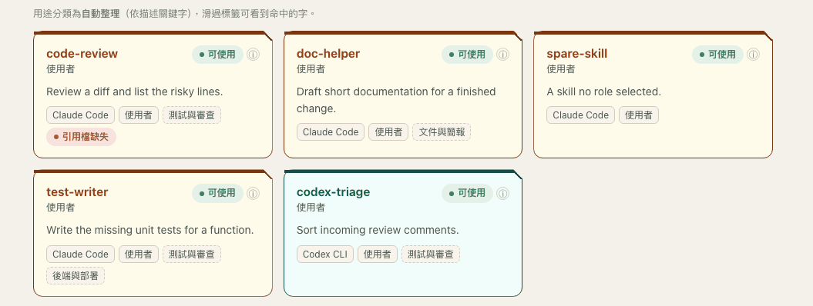

**技能庫**（示範資料）：每張技能卡是一個切掉一角的晶片，頂端有工具顏色的色帶（Claude Code 偏暖色、Codex 偏青綠色），工具也寫成標籤。
「可使用」只表示在該工具會讀的位置找到技能檔、而且沒被停用；不代表有 Agent 正在用它。


**像素辦公室**（示範資料，`#/office`）：隊伍站在任務所在的工作站，每個工作站標題旁有一個小道具（計畫板、實作區的桌子、審查室、合併關卡）；
加粗紅框並寫著「輪到你」的隊伍在等你；右邊的面板說明點一下會看到什麼。紅色只用在「輪到你」。

<p>


</p>

左（示範資料）：每個出勤中的終端坐在一張**辦公桌**（小人下方有一條小木條），狀態寫在頭上的文字框（「工作中」、「等你回覆」、「狀態未知」）；**休息室**放存好的角色卡。
右：一張角色卡的**面板**：名冊角色不在出勤，沒有即時狀態；換種族只改名冊上的圖；同一張卡也顯示它的虛線技能插槽。卡片上的「打開角色卡」會到角色卡池打開那張卡。

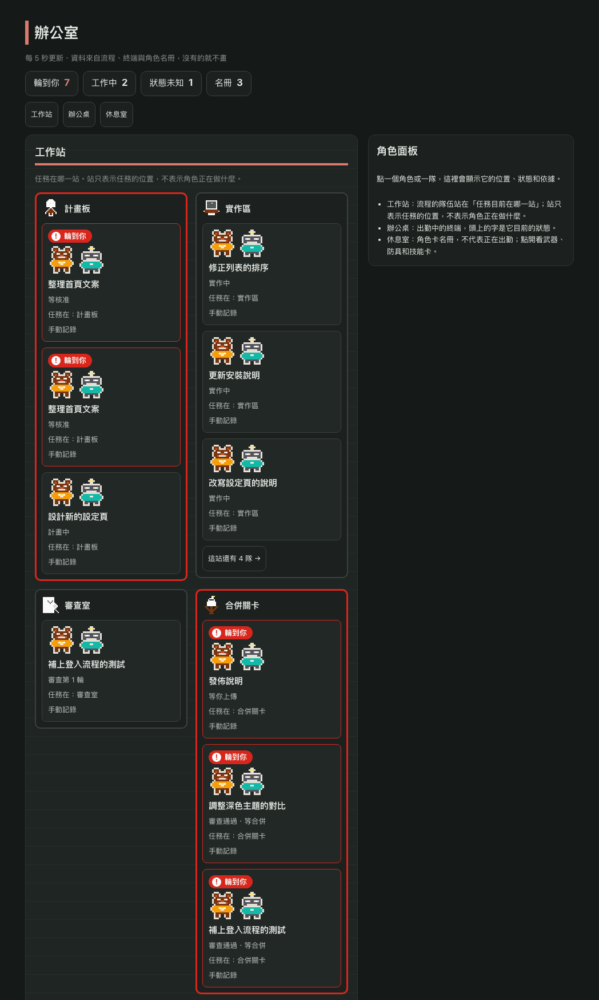

**深色主題**的辦公室（示範資料）：外框變成淺色，角色與道具在深色地板上仍然看得清楚。

辦公桌角色只有「工作中」才交替播放兩幀敲鍵盤動作；工作站與名冊角色保持靜止，系統設定減弱動態時也會停用動畫。
角色面板提供附有來源標籤的狀態回報與可展開的判斷原因，以及可收合的 SVG 角色舞台；螢幕以文字與顏色顯示出勤狀態，
隊伍只顯示任務所在站，角色卡只顯示「名冊」。舞台收合偏好儲存在本機瀏覽器。
角色是原創像素圖，受 [Pixel-Crew](https://github.com/juinwei7/Pixel-Crew)（MIT）呈現辦公室的方式啟發，沒有使用它的圖或程式碼。

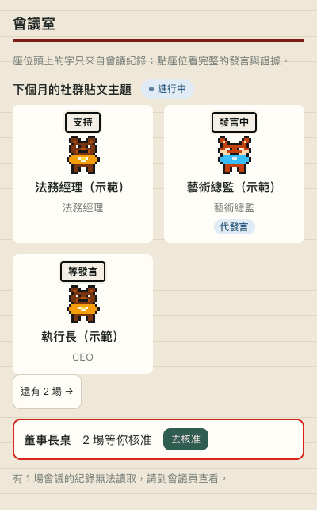

辦公室的**會議室**「會議室」（示範資料）：最新一場進行中的會議，與會者依角色卡的工具畫出，頭上的字只取自會議紀錄（支持、發言中、等發言）；
藝術總監是 AGY 的卡，所以由 Claude 代為發言，標成「代發言」。「還有 2 場」通往其他會議；**董事長桌**「董事長桌」數出等你核准的會議，旁邊是「去核准」。
讀不到的會議紀錄會在下面寫明。

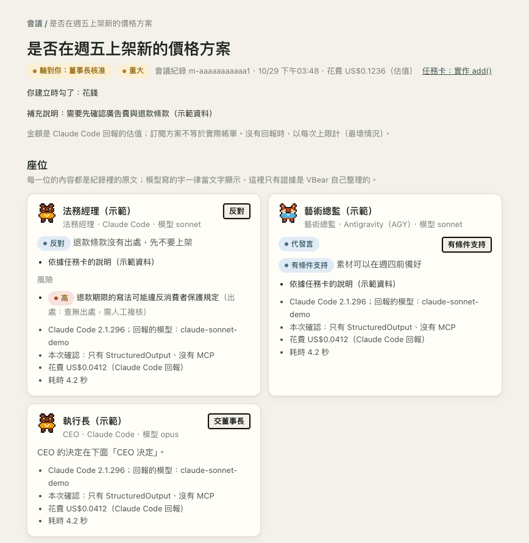

「會議」頁上一場等你決定的**會議**（示範資料）：「輪到你：董事長核准」和「重大」、你建立時勾的項目，以及每位與會者的座位，照紀錄原文列出立場、
重點與風險（法務經理反對，並提出一項沒有出處的高風險：「查無出處，需人工複核」），接著是證據：Claude Code 版本、它回報的模型、
「本次確認：只有 StructuredOutput、沒有 MCP」、Claude Code 回報的花費與耗時。再往下是 CEO 的決定、把它交給你的規則，以及讓你核准或否決的董事長桌。

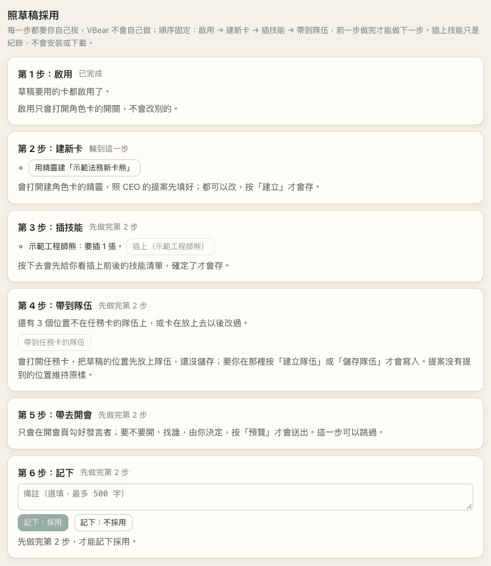

一份**組隊會議**「組隊會議」草稿下方的「照草稿採用」（示範資料）：六個步驟照固定順序排，每一步都是你自己按的按鈕。藝術總監的卡在開會時是停用的，
已經打開了，所以第 1 步寫「已完成」；第 2 步會打開照 CEO 的法務新卡先填好的建卡精靈，後面每一步都等它（先做完第 2 步）。
前四步做完才能按「記下：採用」；「記下：不採用」隨時都能按。

## 你可以用它做什麼

**出發前，先看清楚 Agent 能做什麼。**
用角色卡啟動 Claude Code 時，你會先看到出發通行證：正面三行（寫入範圍、網路有沒有擋、以及擋不住 commit），每行都依實測結果寫；
再點一下「看七項細節」，是七項權限標示（讀取、寫入、測試、commit、部署、網路、檔案系統），每項都寫明守到什麼程度、依據是什麼證據。
啟動要等你確認才會開始。如果有原因擋住出發，原因旁邊有修正按鈕（例如權限意圖還沒決定就有「現在決定」），修好後回到同一張通行證、重新產生預覽。安全模式下，Bash 工具只能寫入工作目錄和
這次專用的暫存資料夾，也不能連網；沒有守住的部分（讀檔、commit），標示會直接說沒有。完整模式的卡，通行證開頭就寫「VBear 沒有限制這張卡」，
並列出確切要執行的指令，一樣要你確認才出發。

**把你已有的技能和角色整理在一起，再把挑選存成角色卡。**
VBear 讀取它在 Claude Code 和 Codex 找到的技能與 Agent 角色，告訴你每一項工具有沒有真的載入、從哪裡來、做什麼用。
每個說法都附上來源。你可以把挑好的技能和職業存成角色卡（那只是記下你的選擇，啟動時不會載入）。你替技能取的名字和備註
只存在本機，不會寫進技能檔。

**看誰在工作、誰在等你。**
Agent 的終端在你 Mac 上的小型背景程式裡執行，關掉瀏覽器分頁也不會中斷。你可以在瀏覽器裡觀看任何一個終端；要在執行中的終端打字必須
明確「接管」，接管前會先出現接手提醒，而且同一時間只有一個分頁能打字。唯一的例外是這個分頁剛從出發通行證開出來的終端，可以直接打字。對你用角色卡啟動、版本有實測紀錄的 Claude Code，主控台會顯示它在工作
還是在等你回覆。

**讓好幾個 Agent 一起做一件事，隨時看得到進度。**
流程會記下誰規劃、誰動手做、誰檢查，以及各自是哪家 AI 的模型。「流程」頁顯示目前階段、審查輪次與時間軸，首頁的告示板先列出輪到你的
關卡。檢查的人和動手做的人必須來自不同家，審查結果才算通過，避免自己審自己；程式碼一變動，這個通過就會標為已過期。

**讓它自己跑，停在關卡等你。**
核准一次計畫後，VBear 可以把計畫交給 Claude Code 執行者、用讀檔核對它的回報、請 Codex 審查、把 NEEDS WORK 的意見
轉回去，最後停在合併關卡。你隨時可以停止，停止後不會自動恢復。這套流程已用真實模型端對端跑過
（[證據](docs/evidence/s3-real-e2e-2026-10-12.md)）。它會消耗你自己帳號的用量。你設定的上限像「停損」：一到，VBear 就停下流程；有些用量要事後才知道，所以實際
可能比上限多，第一次用請把上限設低。VBear 不會替你執行 `git`，合併與 push 都由你自己動手。

**讓各職位開會，重大的事留給你決定。**
在「會議」頁（`#/meetings`，或任務卡上的「開會討論」）寫下議題，選一張 CEO 卡當主席、最多六個其他職位發言。送出任何東西之前，
預覽會列出每次呼叫要送出的全文和可能的花費；按「開始開會」才會開始。每個職位各發言一次、彼此看不到對方的發言，再由 CEO 做決定。
要不要交給你由固定規則判斷，你在「董事長桌」核准或否決。VBear 不會去執行決定：「寫進任務卡」只會把決定填進任務卡的編輯器，要你自己按儲存。

**請 CEO 幫任務卡組隊，再一步一步採用。**
在任務卡上按「請 CEO 組隊」會開一場組隊會議。VBear 照固定規則先勾好發言者並寫出理由，預覽列出每段送出的全文和可能的花費；
接著各職位各發言一次，再由 CEO 卡寫出組隊提案：四個位置各放誰、開會時找哪些幕僚、要新建哪些卡、每張卡插哪些技能。你可以把提案改成草稿
（只存在這個瀏覽器），再用「照草稿採用」照順序做（啟用 → 建新卡 → 插技能 → 帶到隊伍，然後是帶去開會與記下），每一步都是你自己按的按鈕：
建卡精靈照提案先填好、按「建立」才會存；插技能會先列出插上前後的技能、而且只是紀錄；隊伍先放在任務卡上，要你按「建立隊伍」或「儲存隊伍」才會寫入。

**全部留在你的 Mac 上。**
沒有遙測、沒有帳號、沒有雲端。VBear 不對外連線，伺服器只聽 `127.0.0.1`。你啟動的 Agent 仍然用你自己的登入，
和不用 VBear 時一樣，直接連到它們自己的供應商；開會與技能翻譯也一樣，透過你自己的 Claude Code 送出。

## VBear 的承諾（簡短版）

- **守得住的：** 由 VBear 以安全模式啟動的 Claude Code 只能寫入工作資料夾、不能連網、要改檔只能透過 Bash 工具。
- **完整模式下 VBear 不加任何限制。** 完整模式的卡像你自己啟動工具一樣：在工具自己的權限詢問允許的範圍內，讀檔、寫檔、上網、commit、
  發布、付款都做得到。
- **守不住的：** 它仍然讀得到你的帳號讀得到的所有檔案；你自己輸入 `!` 的指令不經沙盒。
- **合併、push、發布一律由你決定。** VBear 不會替你執行 `git`。
- **自動執行會用掉你帳號的額度。** 你設的上限是停損設定，不保證實際帳單。
- **開會會透過你的 Claude Code 把內容送到 Anthropic，並用掉你的額度。** 決定只是紀錄，重大的事會等你核准。組隊會議也一樣送出、一樣花錢；
  組隊提案只是建議，VBear 不會替你建卡、插技能或存隊伍。
- **審查通過（PASS）只是另一個 AI 的意見，不是證明。** 合併前請自己看過變更。
- **刪除流程無法復原。**
- **App 沒有 Apple 開發者簽章。** 第一次要到「系統設定 → 隱私權與安全性」按「強制打開」。
- 完整清單，以及每一項你可以怎麼做，見[使用前要知道的事](#使用前要知道的事)。

## 新手村：3 步開始

**出發前準備：** 你的 Mac 已經裝好並登入 Claude Code（[取得 Claude Code](https://claude.com/product/claude-code)）。VBear 會
替你啟動它，但不會替你安裝。

1. **安裝。** 從[最新版本](https://github.com/sidphoto/vbear/releases/latest)下載 `VBear-<版本>-arm64.dmg`，打開後把
   **VBear** 拖進「應用程式」。第一次打開時 macOS 會拒絕：到「**系統設定 → 隱私權與安全性**」往下找到 VBear，
   按「**強制打開**」。Homebrew 與從原始碼執行見下方「安裝與使用」。
2. **打開 VBear。** App 會開出自己的視窗，第一頁是任務告示板「冒險者大廳」，左邊選單有「冒險者大廳」「辦公室」「會議」「終端機」「終端工作台」「流程」「技能庫」
   「角色卡池」「專案」「設定」（視窗窄到手機寬度時，選單會收成一個按鈕，上面寫著目前的頁名）。VBear 會列出在你 Mac 上找到的技能與 Agent 角色（唯讀，不會修改任何一個）。
   首頁最上方的「新手第一局」會用三步帶你走一遍。
3. **收集、導入專案、出牌。**
   - 打開「**角色卡池**」，按「**用起手牌組開始**」一次拿三張現成的卡（CEO、全端工程師，以及給審查關卡用的審查員，不用打字）；或按「**＋ 新角色卡**」，
     用三步精靈（名字與外觀；陣營、職位、職位指示與出發方式；技能卡）自己做。這台電腦找不到 Codex 時，審查員那張卡預設不勾。三張卡都是安全模式的卡，
     權限意圖都是安全模式能啟動的那一組（讀取、寫入、測試允許，部署拒絕）。
     安全模式的 Codex 卡燈號是中性的「不能直接開終端」：VBear 目前還不能替 Codex 加沙盒啟動，但放在任務卡審查位時，自動審查會用它。
   - 在首頁按「**＋ 任務卡（導入專案）**」，從「VBear 在你電腦上看到的專案」、「最近用過」挑一個資料夾，或貼上路徑
     （App 視窗另有「選擇資料夾…」）。檢查結果會寫出這個資料夾是不是 git 儲存庫、分支與 HEAD；不是的話會警告：任務卡
     仍可建立，但隊伍的審查結果要綁定 commit，在這個資料夾裡不會算數，合併關卡也用不了。VBear 不會替你執行 `git init`。
   - 把角色卡放上任務卡的隊伍位置（點位置從角色卡池挑、拖放，或在卡上按「**放上任務卡**」）。然後在卡上按「**出發**」，打開出發通行證。
   - 看出發通行證。完整模式的卡會寫「VBear 沒有限制這張卡」並列出指令，你確認後工具就像在你自己的終端機一樣啟動。安全模式的卡，看正面的三行。「只能改這個資料夾」和「擋住網路」只有在這次啟動真的驗證過才會出現；否則會寫「部分擋住」「還沒實測」
     或「不明」。commit 那一行永遠寫擋不住。點「看七項細節」會看到七項標示，分在五個框裡（擋住了、部分擋住、沒有專用權限、沒有擋、未證明），
     每一項仍保留自己的名稱和說明守到什麼程度的字，下面還有「已選清單，本次不會載入」。字的意思：「強制」和「部分強制」代表這項限制真的守住；
     「僅意圖」「未限制」「未驗證」「未知」代表沒有強制或沒有證明；「不授予」代表根本沒有給這個權限。讀取不受限，你能讀的檔案它也讀得到。
   - 安全模式要勾選「我知道這個角色會在這個資料夾建立、修改檔案，也能存下版本紀錄（commit），VBear 擋不住」。滿意了再按「**確認啟動**」。

## 使用前要知道的事

VBear 的原則是：守得到哪裡，就說到哪裡；守不到的地方，也照實說。下面是守不到的地方，以及你可以怎麼做。

- **完整模式的卡就是你自己的終端機。** VBear 不替它加沙盒、不加 `--safe-mode`、不限工具、不擋網路，權限意圖也不套用；
  只剩工具自己的權限詢問。請只對你願意在自己終端機裡放手的卡選完整模式，並在替它挑好的資料夾出發。
- **檔案仍然讀得到。** 用安全模式角色卡啟動的 Claude Code 只能寫入工作目錄和它自己的暫存資料夾，也不能連網；但你的 Mac 帳號
  讀得到的檔案，它都讀得到。選工作目錄時請把這點放在心上。
- **你自己輸入 `!` 的指令不經沙盒。** 在 Claude Code 裡以 `!` 開頭自己輸入的指令，是以你的身分直接執行、沒有沙盒。
  只在你確定要執行時才輸入；預覽畫面也有標示。
- **目前無法阻擋 commit。** 工作目錄的 `.git` 是可寫的，Agent 可以在裡面存下 commit（commit 是 git 裡一份存起來的程式碼
  快照）。啟動前要勾選知悉；合併或 push 之前請先看過歷史紀錄。出發通行證的正面把這件事單獨寫成一行。
- **權限意圖是記錄，不是鎖。** 角色卡上的四項權限意圖（讀取、編輯、測試、部署）是用來標記隊伍分工的。安全模式只有一種組合能出發
  （讀取、編輯、測試允許，部署拒絕）；選了別的組合，卡片會說明為什麼不能出發。完整模式完全不套用權限意圖，通行證會把寫成「拒絕」的項目
  列為不會遵守。真正的限制只看出發通行證。
- **安全模式只有一種啟動設定。** 只開放 Bash、停用 Edit/Write、不連網。唯讀的安全模式出發與加沙盒的 Codex 出發還沒有做；
  完整模式是另一種出發方式。
- **安全模式啟動的 Claude Code 不使用技能。** VBear 用 `--safe-mode` 啟動 Claude Code，依 Claude Code 自己的說明，它會關掉
  技能、CLAUDE.md、已安裝的外掛、hooks、MCP 伺服器與自訂指令和 Agent，登入與模型選擇則照常。VBear 的啟動另外只開放 Bash 工具，所以沒有其他內建工具可用。
  因此角色卡的技能欄
  只是你的挑選紀錄，不是啟動時會載入或使用的東西。你自己在終端機裡啟動的 Claude Code 不是 VBear 啟動的，不受影響。
  2026-10-14 在 Claude Code 2.1.299 實測：在放了專案層技能的暫存專案裡，用 VBear 的旗標啟動，技能清單沒有使用者與專案的任何技能
  （不加旗標的對照組有），工具清單只有 Bash，所以連內建技能也沒有 Skill 工具可以呼叫。
- **「工作中／等你回覆」不是每個地方都知道。** 只對你用角色卡啟動、且版本有實測紀錄的 Claude Code 判斷（內建 2.1.291、
  2.1.292，以及在你的 Mac 上驗證過終端標題的版本）。Claude 自動更新後，新版本會先顯示「狀態未知」，到出發通行證按
  「驗證這個版本」即可。它分不出是在等你輸入還是等你確認，其他終端、完整模式的終端與 Codex 一律顯示「狀態未知」。
- **任務卡只有 commit 改變才會過期。** 核准之後沒提交的修改不會讓結果失效，所以請先 commit 再核准。
- **自動執行不需要你在場。** 它會消耗你兩個帳號的用量。你設定的上限像「停損」：一到，VBear 就停下流程；有些用量要事後才知道
  （例如花費），所以實際可能比上限多，各項上限的強度也不同；第一次用請把上限設低。審查意見（內容會受被審的程式碼影響）不經你逐則核准就會送給執行者；被停止的那一輪，執行者可能繼續跑到自己結束。
  背景程式重啟之後，自動流程會停下，要由你按「繼續」：VBear 會先檢查風險接受、上限等條件；被中斷的那一輪會以最壞情況計入
  （常見的結果是把額度算到用完），這時要提高上限、重新接受，再重新核准自動執行。它已用真實模型在一個小型的示範專案上
  端對端驗證（Claude Code 2.1.296 當執行者、Codex 0.160.0 當審查者；三次執行：完整流程、停止、主控台重啟）：這是「照設計
  運作」的證據，不是對你的專案的保證。建議第一次用較低的上限，並先讀[證據](docs/evidence/s3-real-e2e-2026-10-12.md)與
  [安全模型](docs/SECURITY-MODEL.md#phase-3-automatic-mode)。
- **開會是意見，而且會送到 Anthropic。** 每次發言都是一次沒有工具的 Claude Code 呼叫，每次都會檢查；內容會用你的帳號送到 Anthropic
  （任務卡的資料夾路徑不會送出）。金額是 Claude Code 回報的估值，有每次、每場、每天三層上限（`meeting_limits`）；訂閱方案不是這樣計費。
  VBear 只檢查法務有沒有寫出處，不檢查出處是不是真的，也無法確認會計師真的用程式算。把決定交給你的關鍵字表可能漏掉換句話說的內容，
  所以開會時請勾選「涉及」的選項。核准只是主控台裡的一筆紀錄（主控台記錄（未驗證身分）），不能證明是誰按的。
- **審查 PASS 不是證明。** 讓 Agent 動手、再請 Codex 審查，有些風險要你每個流程先接受一次（Codex 的工具事先列不完整、
  它的多 agent 能力關不掉只能偵測、各項上限強度不一、組織管理的 Claude 設定在本機看不到）。同一份內容兩次審查的結論
  可能不同，所以合併前請自己看過變更。刪除流程無法復原；紀錄損壞或無法證明屬於這個流程的資料會被拒絕刪除並說明原因，
  沒有「強制刪除」，需要自己動手處理（見[流程無法刪除時](docs/SECURITY-MODEL.md#when-a-flow-cannot-be-deleted)）。
  完整清單見[安全模型](docs/SECURITY-MODEL.md#phase-2-coordination)。
- **以你的帳號執行的程式可以操作 VBear。** 其他網站和其他使用者帳號會被擋下：每次呼叫都要帶一組每次啟動就會更換的通行證，
  存在只有你能讀的檔案裡。但以你的帳號執行的程式也讀得到這個檔案，所以請把 VBear 當成和你帳號下其他程式一樣看待。
  詳見[安全模型](docs/SECURITY-MODEL.md)。
- **App 沒有 Apple 開發者簽章。** macOS 第一次會拒絕開啟，需要到系統設定允許一次（見下方「安裝與使用」）。

## 支援的 Agent

| Agent | 在終端中觀看與輸入 | 角色卡完整模式出發（VBear 不加限制） | 角色卡安全模式出發（含出發通行證與沙盒） |
|---|---|---|---|
| Claude Code | 可以 | 可以：`claude [--model X] [--append-system-prompt …]`，職位指示是其中一個引數 | 可以。已驗證的版本（2.1.286、2.1.291、2.1.292、2.1.296，以及你自己驗證過的版本）會有強制的標示；其他版本要勾選你知道它**未驗證**才會啟動 |
| Codex CLI | 可以 | 可以：`codex [-m X]`；職位指示只能用「貼上職位指示」 | 不行：通行證會說明原因（0.159.2 的互動模式仍會載入你的全域設定） |
| Antigravity（AGY） | 只有完整模式開出來的終端可以 | 可以：`agy [--model X]`；職位指示只能用「貼上職位指示」 | 不行：安全模式的 AGY 卡只是排隊伍用的記錄（可以放上任務卡的隊伍），出發通行證會直接這樣說 |

執行者（流程在背景執行的 Claude Code）需要 Claude Code 2.1.292 或 2.1.296；Codex 審查需要 Codex 0.160.0。
其他版本在任何東西啟動之前就會被拒絕並說明原因。開會需要通過無工具安全檢查的 Claude Code 版本（見下方）；完整模式不看版本。

技能與角色的掃描讀取 Claude Code（`~/.claude`）、Codex（`~/.codex`）與共用技能（`~/.agents`），不會修改它們。

為了判斷 Antigravity（AGY）會讀哪些技能，VBear 還會看專案的 `.agents/skills`、`~/.gemini/antigravity-cli/skills`，以及
`~/.gemini/config/skills.json` 列出的資料夾；只讀檔案，不會執行 `agy`。在這些位置的技能會標成「AGY 會讀」（VBear 已經認得的
技能是加上標記，不會再複製一份；新的資料夾則新增為 AGY 來源）。`~/.gemini` 底下其他檔案一律不開，共用庫 `~/.agents/skills` 除非
上述設定檔有列出，否則不算 AGY 會讀的；AGY 內建與外掛的技能不在範圍內。AGY 會讀的技能不等於 VBear 會載入：安全模式不會啟動 AGY，完整模式下 AGY 照它自己的設定讀，和不用 VBear 時一樣。
詳見 [docs/SECURITY-MODEL.md](docs/SECURITY-MODEL.md)。

## 安裝與使用

### 下載 App（建議）

1. 從 [最新版本](https://github.com/sidphoto/vbear/releases/latest) 下載 `VBear-<版本>-arm64.dmg`，打開後把 **VBear** 拖進「應用程式」。
   需要 Apple 晶片（M1 以後）的 Mac、macOS 13 以上；App 已內含 Python，不必另外安裝。
2. **第一次打開**：App 目前沒有 Apple 開發者簽章，macOS 第一次會拒絕開啟。請到「系統設定 → 隱私權與安全性」，
   往下找到 VBear，按「強制打開」。只需要做一次。

也可以用 Homebrew：`brew install --cask sidphoto/tap/vbear`

App 預設使用視窗模式。「顯示方式 → 在瀏覽器中開啟」會用預設瀏覽器開啟目前主控台；勾選「啟動時用瀏覽器開啟」，
之後啟動 App 就會開啟瀏覽器並自行結束，背景伺服器繼續執行。啟動時按住 **Option** 可改用視窗模式，並在選單取消偏好。
瀏覽器啟動失敗或超過 15 秒時，App 會改用視窗模式並顯示錯誤說明。

視窗模式下，結束 App 會關掉視窗及它自己啟動的伺服器；你開的終端機會繼續執行，下次打開 VBear 時還在。

### 從原始碼執行

需要 macOS、Python 3.13 以上；角色卡啟動另需 Claude Code。尚未驗證的版本也能啟動，但權限標示會是「未驗證」，啟動前要勾選知悉；出發通行證的「驗證這個版本」會用你的 Claude 帳號做 2 次小型模型呼叫來驗證（約 1–3 分鐘），通過後這個版本在你的 Mac 上就算已驗證。不需要安裝任何套件。

```sh
git clone https://github.com/sidphoto/vbear.git && cd vbear
python3 -m vbear serve --open   # 啟動並開啟 http://127.0.0.1:7788
python3 -m vbear launch         # 背景啟動（若尚未執行）並開啟瀏覽器
python3 -m vbear doctor         # 檢查來源與 VBear runtime 連線
python3 -m vbear scan           # 重新掃描並輸出摘要
```

Agent 終端由 `vbear runtimed`（VBear runtime 背景程序）執行；主控台需要時會自動啟動它，主控台關閉後它會繼續執行，
已開啟的 Terminal 不會因此中斷。

## 隱私

- **沒有遙測、沒有帳號、沒有雲端**：VBear 不對外連線，伺服器只綁定 `127.0.0.1`。
- 使用紀錄只擷取技能名稱、模型名稱、工作階段 ID、工作目錄與時間；對話內容不會被讀出或保存。可在設定頁關閉。
- 你啟動的 Agent 用你自己的登入連到它們自己的供應商，和不用 VBear 時一樣。開會與技能翻譯透過你自己的 Claude Code 送到 Anthropic，
  而且只在你看過預覽或確認之後才送。

## 卡片背後的細節

- **內建終端機**：在「終端機」頁選一個家目錄內的資料夾，就能開你的登入 shell 直接打字，多個終端機以分頁切換。
  這是以你的帳號執行的一般終端機，**不受沙盒限制**，畫面上會標示。
- **終端工作台**：Agent 終端在你 Mac 上的小型背景程式（稱為 *VBear runtime*）裡執行，關掉瀏覽器分頁或主控台都不會中斷。你可以在
  瀏覽器裡觀看任何終端；要在執行中的終端打字必須明確接管（先出現接手提醒），而且同一時間只有一個分頁能打字；這個分頁剛從出發通行證開出來的終端可以直接打字。從任務卡出發時會留在工作台，新終端開在那張卡旁邊。
- **完整模式出發**：出發方式是完整模式的卡，會在你選的資料夾啟動 Claude Code、Codex 或 AGY。指令由伺服器組成，是一串引數（不經 shell），
  顯示在出發通行證上：`claude [--model X] [--append-system-prompt …]`、`codex [-m X]` 或 `agy [--model X]`。VBear 不加沙盒、不加
  `--safe-mode`，工具會用你自己的設定、技能、`CLAUDE.md`、MCP 伺服器、外掛，也可以上網。你仍然要確認這個確切的指令；卡片改過或程式檔換過，
  預覽就作廢。終端會出現在辦公室與終端工作台，狀態寫「狀態未知」，因為沒有任何訊號經過檢查。詳見[安全模型](docs/SECURITY-MODEL.md#full-mode-launches)。
- **有預覽、有沙盒的 Claude 啟動（安全模式）**（由 VBear 啟動並看管的 Claude Code）：選一張角色卡和工作目錄，會看到出發通行證，正面三行之後是七項權限標示（讀取、寫入、測試、commit、
  部署、網路、檔案系統），每項都寫明強制程度與證據。你確認後才會啟動。Claude 的 Bash 工具只能寫入工作目錄與
  這次執行專用的暫存區，也不能連網。執行結束後，只有在確認這次執行的所有程序都已結束時，才會清掉那些檔案。
- **技能與角色庫**：讀取 Claude Code 與 Codex 已安裝的技能與 Agent 角色，顯示工具有沒有真的載入、從哪裡來、做什麼用。
  每項資訊標示來源，沒有來源就寫「未知」。
- **專案與團隊檢視**：依 git 儲存庫與 Agent 角色歸類執行中的終端；也會顯示每次執行實際用了哪個模型、哪些技能
  （讀自 Agent 自己的紀錄檔）。
- **工作中／等你回覆**：對角色卡啟動、版本有實測紀錄的 Claude Code（內建 2.1.291、2.1.292，以及在你的 Mac 上驗證過
  終端標題的版本），主控台依 Claude 自己設定的終端標題顯示它在工作還是在等你，並在首頁告示板列出等你的那些。每個狀態都
  寫明依據；其他情況顯示「未知」。出發通行證的「驗證這個版本」會在驗證啟動邊界的同一次執行中檢查終端標題。
- **任務卡**：本機的目標、範圍與驗收清單。狀態把「Agent 自己說完成」、「測試回報通過」與「你核准」分開顯示，主控台
  不會把任務卡標成「已驗證」。有工作目錄時，測試結果與核准會綁定給出當下的 commit，commit 一變就標為已過期。把卡片標成
  完成或阻塞時會問接下來怎麼辦；交接會結案原卡並開一張接手的新卡、保留前面的鏈，新卡會顯示「接手提醒」，寫明前一張卡與它的交接說明；有沒有人在處理由連結的終端推算，不是手動輸入。
- **流程看板（只看、只記錄）**：一張任務卡由多個 Agent 合作完成時，記下誰規劃、誰執行、誰審查（含模型家族，也就是模型出自哪一家：Anthropic、OpenAI、Google 等）。
  「流程」頁顯示目前階段（計畫中、等核准、實作中、審查第 N 輪、等修正、審查通過・等合併、審查結果已過期、等你上傳、完成）、
  審查輪次與時間軸，首頁告示板的「輪到你」先列出等你處理的關卡。階段每次讀取時由事件（含自動執行時 VBear 自己寫入的事件）與即時資料推導，不儲存。
  審查者與執行者必須是不同且已知的模型家族，審查結果才算通過；執行者的工作目錄離開被審查的 commit，通過就標為已過期。
  你用表單記錄的事件標示「手動記錄（未驗證）」。看板的記錄路由不會派工、輸入指令、執行 git，也不會啟動 Agent
  （下面的執行者是另外的路徑）；流程頁和首頁一樣會讀取即時狀態，可能因此啟動 VBear 自己的 runtime。
- **執行者與審查（第 2 階段）**：在流程裡可以啟動由 VBear 在背景執行的 Claude Code 執行者（沒有終端），並請 Codex
  在獨立的沙盒 clone 裡審查它最新的 commit。每個流程要先接受三項殘餘風險；每則派工都先預覽實際送出的文字、再由你核准；
  執行者自己的回報與 VBear 讀檔核對的結果分開顯示；審查者的報告一律以純文字顯示；合併與 push 的指令只顯示、由你自己執行，
  VBear 不會替你執行 git。需要 Claude Code 2.1.292 或 2.1.296 與 Codex 0.160.0（已驗證的版本），會消耗你自己帳號的用量。資料會保存到
  你刪除流程為止。使用前請先讀[安全模型](docs/SECURITY-MODEL.md#phase-2-coordination)。
- **自動執行（第 3 階段）**：核准計畫之後，VBear 可以自己跑迴圈：派計畫給執行者、用讀檔核對它的回報、請 Codex 審查、
  把 NEEDS WORK 的意見（標明為資料）轉回去，最後停在合併關卡等你。核准畫面一次列出整份計畫、上限、帳號與全部風險；
  你隨時可以停止；停止後不會自動恢復；背景程式重啟會把所有自動流程標成停止。VBear 仍然不會替你執行 git。這套流程已用真實
  模型端對端驗證（Claude Code 2.1.296 與 Codex 0.160.0：完整跑到合併關卡、審查進行中按停止、審查進行中重啟主控台；
  見[證據](docs/evidence/s3-real-e2e-2026-10-12.md)）。背景程式重啟之後，自動流程會停下，要由你按「繼續」：VBear 會先檢查原有的風險接受是否仍有效，以及 HEAD、審查與上限等條件。被中斷的那一輪會以最壞情況計入（常見的結果是把額度算到用完），這時要提高上限、重新接受，再重新核准自動執行。
- **會議**：「會議」頁（`#/meetings`）一場只有一輪文字討論：主席（啟用中、卡上存的職位是 CEO 的卡）加最多六位發言者，每個職位一張卡，
  每位各發言一次、彼此看不到，最後由 CEO 做決定。「預覽（還不會開始）」列出每張卡的職位指示、每次呼叫要送出的全文（任務卡的欄位，
  不含資料夾路徑；像密碼金鑰的字串會遮蔽）、模型、呼叫數、預留金額與今天的花費；按「開始開會」才會開始，一次只跑一個呼叫。每次呼叫都是
  完全沒有工具的 Claude Code：開頭只能列出 StructuredOutput、沒有 MCP，否則立刻停止、結果不採用，這個版本要重新檢查（「先做無工具安全檢查」，
  和翻譯是同一個檢查）。Codex 或 AGY 卡由 Claude 照那個職位的指示代發言。固定規則 R1–R8 決定要不要交給你（輪到你：董事長核准）：你勾的「涉及」、
  決定裡的動作、關鍵字、金額、高風險或沒有出處的風險、法務反對、發言失敗，或有人要求交給你；模型只能把事情升級。你在「董事長桌」核准或否決
  （主控台記錄（未驗證身分））。上限在 `config.json` 的 `meeting_limits`（預設每次 US$0.20、每場 1.50、每天 3.00），今天用到 80% 亮黃燈、
  到 100% 不能再開會。發言失敗只會由你重試，最多兩次；主控台重啟後不會自動續跑。每場會議是狀態目錄 `meetings/` 底下的一個檔案；
  不寫任務卡、流程，也不寫專案資料夾。詳見[安全模型](docs/SECURITY-MODEL.md#meetings-tool-less-headless-speech)。
- **畫面上的名稱**：部分名稱已改成和上面的遊戲用語一致（舊 → 新）：「Agent 團隊」→「角色卡池」；「Agent Profile」「Profile」→「角色卡」
  （「建立 Agent Profile」按鈕是「＋ 新角色卡」）；「已選技能」→「技能卡」（「收藏中」或「生效中」）；「工具（遊戲用語：陣營）」→「陣營」；
  「Permission Intents」→「權限意圖」（讀取檔案、編輯寫入、執行測試、部署上線；允許、拒絕、還沒決定）；「出發前檢查」→「出發通行證」；
  通行證裡的「防具」標題→「七項標示」（「防具」只留作角色卡背面的分類名稱）；「任務卡＋選填的工作目錄」→「任務卡」就是一個資料夾；
  流程的 planner／executor／reviewers→「規劃位、執行位、審查位」；缺什麼的紅字→「下一步」清單，每一步寫明輪到誰。更早的更名：「角色裝備」分頁 →「角色」；
  「職業角色」→「職業」（現在叫「職業標籤」）；「預覽並啟動」→「出發前檢查」→「出發通行證」；各項上限的標題「上限」→「體力（停損設定）」；流程的「階段」→「任務進度」、流程頁的「角色」區塊→「隊伍」。v0.9.0 的建議位置：「規劃」「執行」「審查」→「CEO」「全端工程師」「獨立審查」
  （徽章「規、執、審」→「長、工、審」；任務卡的三格進度燈仍是「規、執、審」，因為那是階段），起手牌組的「工匠」→「全端工程師」。
- **我的註記**：替技能取易懂的名稱、標籤與備註，只存在本機，不會寫進技能檔。

## 技術細節

- **只用標準函式庫**：後端僅使用 Python 3.13+ 標準函式庫（零 pip 套件、零雲端服務）。前端介面沒有建置步驟，唯一依賴是
  本機打包的 MIT 開源套件 `@xterm/xterm` 與 `@xterm/addon-fit`（置於 `web/vendor/xterm/`，鎖定版本，並由單元測試持續驗證
  固定的 SHA-256 雜湊），嚴格拒絕 CDN 外部載入，維持嚴格 CSP `script-src 'self'`。
  需要 Python 3.13 以上（Agent CLI 版本檢查需要 `os.waitid`，macOS 從 3.13 才提供）；macOS 系統內建的 `/usr/bin/python3` 是 3.9，會啟動失敗，請改用 Homebrew 等較新的 `python3`。
- **外部來源唯讀**：只讀取你選的外部工具來源，不修改任何技能或角色檔案，不執行技能內的腳本（VBear 本身之設定、註記與終端操作除外）。
  終端工作台提供本機 Agent pane 的畫面串流與受控輸入通道（見[參考資料](docs/REFERENCE.zh-TW.md)的「安全」），其餘外部來源相關功能維持唯讀。
- **有來源才顯示**：每項資訊標示「作者說明／自動整理／執行觀察／未提供」，查不到就寫未知。
- **更多**：架構見 [ARCHITECTURE](docs/ARCHITECTURE.md)，威脅模型與已知缺口見[安全模型](docs/SECURITY-MODEL.md)。

## 參考資料

畫面導覽、資料從哪裡來、我的註記、技能狀態、安全細節、狀態目錄與原始碼結構，已搬到 [docs/REFERENCE.zh-TW.md](docs/REFERENCE.zh-TW.md)。

## 授權

[MIT](LICENSE)。內附的 xterm.js 與 fit addon（`web/vendor/xterm/`）為其作者的 MIT 授權，見 `web/vendor/xterm/LICENSE`。

## 社群與支援

- 問題與想法：[GitHub Discussions](https://github.com/sidphoto/vbear/discussions)
- 錯誤回報與功能需求：[GitHub Issues](https://github.com/sidphoto/vbear/issues)
- 資安問題請**不要**開公開 issue，見 [SECURITY.md](SECURITY.md)。

中文或英文皆可。開發方式見 [CONTRIBUTING](.github/CONTRIBUTING.md)。

## 關於

VBear 的名字來自台灣黑熊和牠胸前的 V 字：先看清楚，再放行。

v0.1.0 以前叫「SID Console」，最早依附 Herdr 執行終端（「SID Console for Herdr」）。第一次啟動時會自動把舊的 `~/.sid-console` 搬到 `~/.vbear`。Herdr 相容層已移除，最後一個支援 Herdr 的版本標記為 git tag `last-herdr`。
舊設定的 `runtime_kind: herdr` 會在啟動時自動改為 native，並提示一次。

### 技能說明中文化（候選功能）

技能庫、Armory／工作台的技能卡與技能詳細頁可顯示「做什麼／何時用／需要什麼」中文整理，
並標明機器翻譯、引擎、模型與時間；作者原文可切換查看。原文變更後保留舊翻譯並標示過期，
中文翻譯也納入搜尋。作者未提供的資料保持「作者未提供此資訊」；翻譯不代表經過驗證的技能能力，
不會修改原本的技能檔案。

單項與批次翻譯都會先說明送出的作者欄位、使用自己的 CLI 登入與額度，以及費用與等待限制。
設定預設 Claude Haiku，也可選 Codex。自動重翻預設關閉，開啟需對目前引擎確認；每次從主控台
重新掃描後，背景最多翻譯 20 個未翻／過期項目，其餘等待下一次掃描。全域進度列可停止工作，
切換頁面或重新整理後仍可查看；做完的工作 5 秒後自動收起，失敗的 10 秒後收成右下角的小圓點（點開看原因），
每個狀態都有關閉鈕；失敗也會寫在發起翻譯的那張技能卡上，並附「重試」。確認視窗的主文只有一句話：會用你自己的帳號，通常每張不到 1 美分，
完整的預算與逾時說明收在「詳細」裡。更換引擎會關閉自動重翻，需重新同意；關閉也會取消目前工作。
清除索引已不存在的孤兒翻譯需兩次確認，只刪除快取。Claude 每項請求預算 US$0.05 並非保證帳單上限；
Codex 費用與 Token 消耗顯示未知。

**翻譯要先通過檢查才會執行。** 安裝的 Claude Code 版本要先用你自己的帳號做一次檢查，確認翻譯呼叫只有 StructuredOutput、
沒有 MCP（設定頁「驗證翻譯安全邊界」）；通過紀錄依版本存在 `translation-boundaries.json`，開會的檢查也是同一個探測、同一份紀錄。
通過之前不會啟動任何程式。Codex 引擎可以選，但每次翻譯都會拒絕，因為它的邊界無法證明。測試沒有呼叫真實 CLI 或模型。

AGY 可用隔離主控台執行完整假翻譯情境：

```sh
VBEAR_QA_TRANSLATE=1 VBEAR_QA_SERVE=1 python3 -m unittest tests.qa_game_ui.Serve -v
```

只使用情境印出的登入網址與假 HOME 路徑；情境會準備已翻／過期／未翻／孤兒，列出瀏覽器檢查清單，
兩個引擎選項都只執行假 CLI。`python3 -m unittest tests.qa_game_ui.TranslationCheck -v` 可驗證兩個假引擎、
原文更新判定及孤兒清除。完整 Python 套件與 1280／390、淺／深色實機 QA 仍交由 AGY 獨立驗收。
