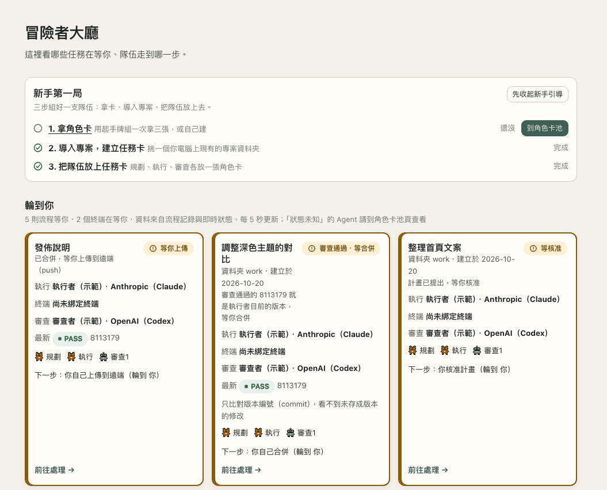
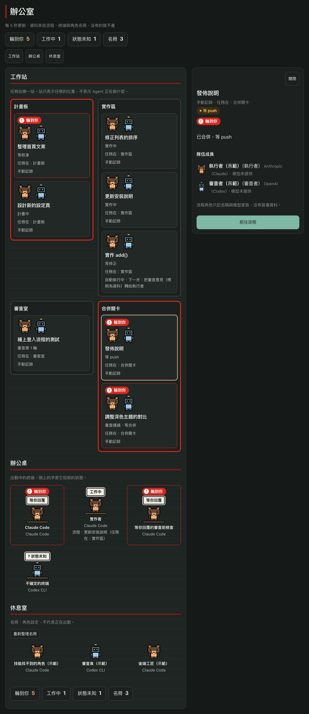
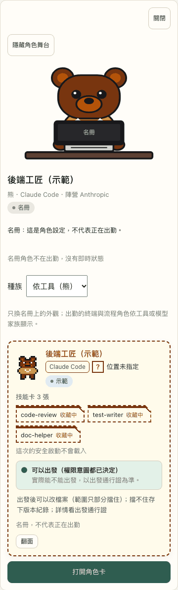
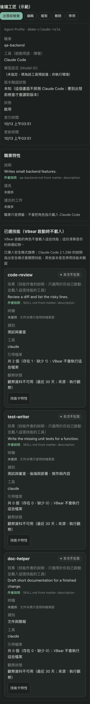
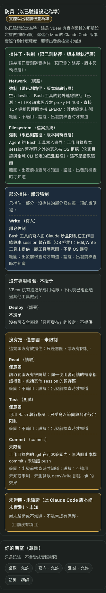
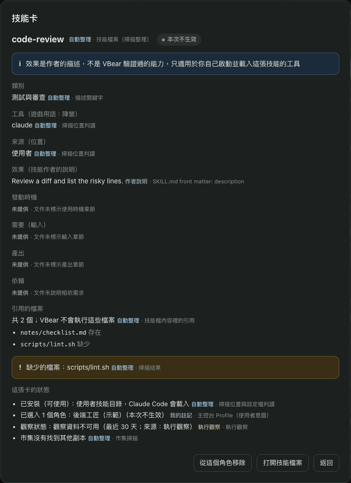
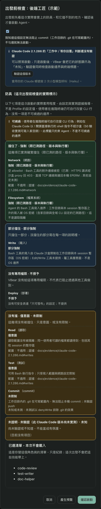
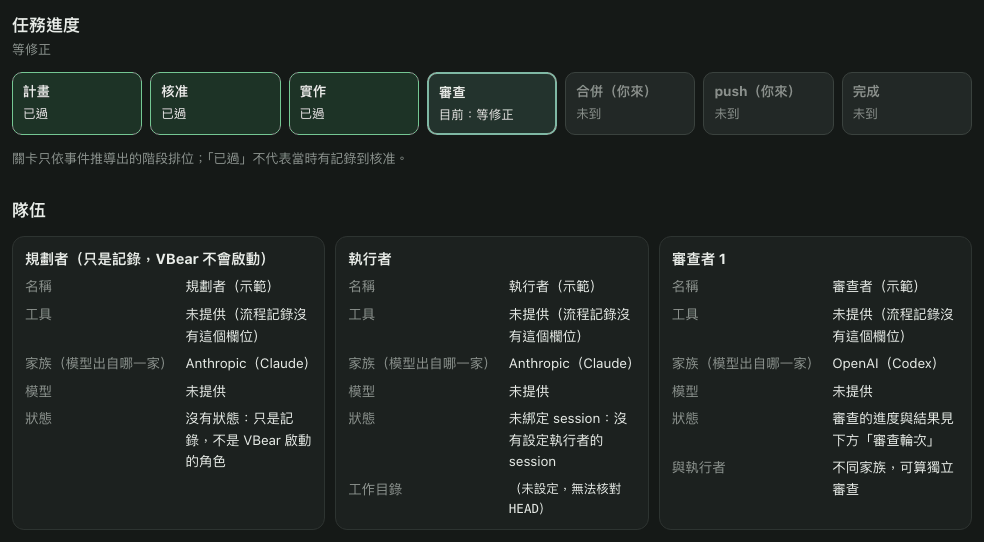
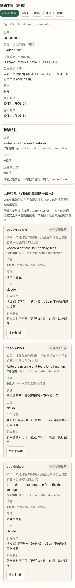

# VBear

**像選遊戲角色一樣挑選你的 AI 寫程式助手：出發前，先看清楚它的職業、技能和出發通行證。**

VBear 是跑在你自己 Mac 上的主控台。你用它的角色卡啟動 Claude Code 時，它會在啟動「之前」先告訴你這次允許做什麼；
它也讓你看到誰在工作、誰在等你，以及多個 Agent 合作時會在哪些關卡停下來等你核准。（你在 VBear 裡自己開的終端機分頁，
是一般的終端機，不在這些保護裡。）

[English](README.md) · [架構](docs/ARCHITECTURE.md) · [安全模型](docs/SECURITY-MODEL.md) · [參與貢獻](.github/CONTRIBUTING.md) · [回報資安問題](SECURITY.md)

> **目前狀態：早期版本（v0.3）**，只在 macOS 上由作者本人日常使用與測試。畫面是繁體中文。
> 開始使用前請先看下方「使用前要知道的事」。

## VBear 是什麼？

Claude Code 和 Codex 可以替你改檔案、跑指令，但你很難知道一次啟動實際上被允許做什麼，也不容易看出好幾個 Agent
合作時各自在做什麼。VBear 把這些放在同一個畫面：你先選好角色、看過它的防具，才讓它出發；如果把一件工作交給一個隊伍，
VBear 會顯示誰負責什麼，並在需要你決定的關卡停下來。

下面的遊戲用語只是幫你讀懂 VBear 的畫面，每一項都對應 VBear 真的有的功能。

| 遊戲裡 | 在 VBear 裡 | 在哪裡看 |
|---|---|---|
| **角色** | **角色卡**：一組存起來、隨時能啟動的設定（名稱、建議位置、工具、技能卡、權限意圖）。所有角色卡放在**角色卡池** | 角色卡池；終端工作台右欄的「角色」分頁 |
| **職業** | 角色卡上的**職業標籤**，從 VBear 找到的 Claude Code／Codex Agent 角色中選取。它只是標籤：啟動時不會把角色的指示載入 Claude Code | 建立角色卡精靈的「進階」 |
| **陣營／種族** | 它用的**工具**（陣營）：Claude Code 或 Codex CLI。目前用角色卡啟動的只有 Claude Code | 角色卡正面 |
| **技能卡** | VBear 找到的 **Skill**：有的已經裝在你的 Mac 上，有的只是市集上還沒安裝的副本。插在角色卡上的插槽是虛線（收藏中：存在卡上，啟動時不載入）或實線（生效中：只有 VBear 回報真的會載入才用，目前沒有任何一種啟動會） | 技能庫，以及角色卡上的插槽 |
| **出發通行證** | 這次啟動**實際穿上的保護，以及它擋不到的地方**。正面三行，各依實測結果寫：寫入範圍、網路有沒有擋，以及固定一行「**擋不住版本紀錄（commit）**」。盾牌實線＝強制、虛線＝只是記錄、空＝沒擋；部分擋住、未實測、不明的項目不畫盾牌，只用文字說明。七項權限標示收在「看七項細節」裡 | 角色卡的「出發」 |
| **任務卡** | 你電腦上的**一個資料夾**。按「＋ 任務卡（導入專案）」把現有的專案導入：VBear 唯讀地檢查資料夾（是不是 git 儲存庫、分支與 HEAD、專案技能數、資料夾裡有幾個終端），不會寫進你的資料夾 | 冒險者大廳、流程、工作台的「任務卡」分頁 |
| **隊伍** | **流程**：同一張任務卡的規劃者（寫計畫的人）、執行者（動手做的人）與審查者（檢查的人），各自標明模型家族。你把角色卡放上任務卡的**隊伍位置**（規劃位、執行位、審查位，另有選填的第二位審查）；審查位若不算數（和執行位同一家，或是共用陣營的卡），立刻變紅並寫明原因。規劃者只是流程裡記錄的角色：自動模式執行的是你核准的計畫，VBear 不會去啟動規劃者 | 任務卡上的隊伍；流程 |
| **任務告示板** | **首頁**（冒險者大廳）：先列出輪到你的（停在關卡的流程、等你回覆的 Agent），再列其他進行中的任務；流程卡上有隊伍小頭像和「下一步輪到誰」。還沒有隊伍的新手，最上方有**新手第一局**：拿角色卡、導入專案、把隊伍放上任務卡，每一步依真實資料打勾。每張卡都是 VBear 已經有的資料，不打分數 | 首頁 |
| **辦公室** | **像素辦公室**頁（`#/office`）：流程的隊伍站在任務目前所在的**工作站**（計畫板、實作區、審查室、合併關卡），出勤中的終端坐在**辦公桌**（角色頭上的字就是它的狀態），存好的角色卡待在**休息室**（名冊：角色設定，不代表正在出勤；最多顯示 24 個，超過時連到「角色卡池」頁看其餘的）。點角色看它的**武器**（啟動會開放的工具，讀自和啟動參數同一組常數）、防具與技能卡。站只表示任務在哪裡，不表示 Agent 正在做什麼 | 辦公室 |
| **關卡** | **核准、合併、push 關卡**：VBear 在這裡停下來等你 | 告示板的「輪到你」與流程頁 |
| **體力** | 自動執行時你設定的**各項上限**：審查次數、派工則數、模型回應數、時間、執行者額度。把它當成「停損設定」：上限一到，VBear 就停下流程。有些用量要事後才知道（例如花費），所以實際可能比上限多；第一次用，建議把上限設低 | 核准畫面與執行者面板的用量表 |

角色卡的玩法是三個動作：**收集**（從角色卡池拿卡，或用三張一組的起手牌組）、**裝備**（把技能卡插進角色卡）、**出牌**（把角色卡
放上任務卡的隊伍位置，然後出發）。角色卡上的權限意圖是隊伍分工的標記，不代表 VBear 已經限制這個程式的真實能力；真正的限制只看出發通行證。

VBear 沒有等級、血量或分數。它只顯示讀得到、查得到的事，查不到就寫「未知」。把技能卡插進角色卡只是
記下你的選擇。VBear 啟動 Claude Code 時用的是它的安全模式。依 Claude Code 自己的說明，這會關掉技能、CLAUDE.md、
已安裝的外掛、hooks 與 MCP 伺服器；技能這一項已在 Claude Code 2.1.299 實測確認。所以目前啟動出來的 Claude Code 不會
使用技能：角色卡的技能欄只是你的挑選紀錄。

### 畫面長這樣

下面的畫面都是**示範資料**：暫時資料夾裡的合成 Claude Code 與 Codex，不是真實的專案。



**任務告示板**（示範資料），也就是首頁：先看「輪到你」，有停在關卡的流程與等你回覆的 Agent（外框加粗，並用文字寫明原因），
再看「其他進行中的任務」。一張卡是一個流程，整張卡都能點進去。手動模式的流程會寫明 VBear 不會替你推進；讀不到的東西不會顯示。



**像素辦公室**（示範資料，`#/office`）：隊伍站在任務所在的工作站；加粗紅框並寫著「輪到你」的隊伍在等你；每個出勤中的終端坐在
一張辦公桌，狀態寫在頭上的文字框；休息室放存好的角色卡。紅色只用在「輪到你」。

辦公桌角色只有「工作中」才交替播放兩幀敲鍵盤動作；工作站與名冊角色保持靜止，系統設定減弱動態時也會停用動畫。
角色面板提供附有來源標籤的狀態回報與可展開的判斷原因，以及可收合的 SVG 角色舞台；螢幕以文字與顏色顯示出勤狀態，
隊伍只顯示任務所在站，角色卡只顯示「名冊」。舞台收合偏好儲存在本機瀏覽器。上方截圖尚未更新至人物化版本。



一張角色卡的**面板**（示範資料）：武器、防具（實線是強制或部分強制，虛線是僅意圖或未限制，每格都有文字）和已選的技能卡。
角色是原創像素圖，受 [Pixel-Crew](https://github.com/juinwei7/Pixel-Crew)（MIT）呈現辦公室的方式啟發，沒有使用它的圖或程式碼。

<p>


</p>

**角色卡**（示範資料）：角色卡的職業標籤、工具、已選技能（每張都標明啟動時不載入），右邊是分成五組、保留原本等級用語的防具。



**技能卡**（示範資料）：每個欄位都標明來源，缺少的檔案會點出來，並說明把它插進角色卡只是記下你的挑選。



**出發通行證**（示範資料；圖中已裁掉顯示資料夾與暫存路徑的幾行）。這張圖是加上三行正面之前拍的，顯示的是「看七項細節」展開後的內容：
七項標示分成五組，已選技能標明「本次不會載入」，確認前先看。



流程的**任務進度與隊伍**（示範資料）：走過的關卡、目前所在的關卡，以及規劃者、執行者、審查者的模型家族，和審查者算不算獨立審查。



同一張角色卡的淺色主題（示範資料）。

## 你可以用它做什麼

**出發前，先看清楚 Agent 能做什麼。**
用角色卡啟動 Claude Code 時，你會先看到出發通行證：正面三行（寫入範圍、網路有沒有擋、以及擋不住 commit），每行都依實測結果寫；
再點一下「看七項細節」，是七項權限標示（讀取、寫入、測試、commit、部署、網路、檔案系統），每項都寫明守到什麼程度、依據是什麼證據。
啟動要等你確認才會開始。如果有原因擋住出發，原因旁邊有修正按鈕（例如權限意圖還沒決定就有「現在決定」），修好後回到同一張通行證、重新產生預覽。Bash 工具只能寫入工作目錄和
這次專用的暫存資料夾，也不能連網；沒有守住的部分（讀檔、commit），標示會直接說沒有。

**把你已有的技能和角色整理在一起，再把挑選存成角色卡。**
VBear 讀取它在 Claude Code 和 Codex 找到的技能與 Agent 角色，告訴你每一項工具有沒有真的載入、從哪裡來、做什麼用。
每個說法都附上來源。你可以把挑好的技能和職業存成角色卡（那只是記下你的選擇，啟動時不會載入）。你替技能取的名字和備註
只存在本機，不會寫進技能檔。

**看誰在工作、誰在等你。**
Agent 的終端在你 Mac 上的小型背景程式裡執行，關掉瀏覽器分頁也不會中斷。你可以在瀏覽器裡觀看任何一個終端，要打字必須
明確「接管」，而且同一時間只有一個分頁能打字。對你用角色卡啟動、版本有實測紀錄的 Claude Code，主控台會顯示它在工作
還是在等你回覆。

**讓好幾個 Agent 一起做一件事，隨時看得到進度。**
流程會記下誰規劃、誰動手做、誰檢查，以及各自是哪家 AI 的模型。「流程」頁顯示目前階段、審查輪次與時間軸，首頁的告示板先列出輪到你的
關卡。檢查的人和動手做的人必須來自不同家，審查結果才算通過，避免自己審自己；程式碼一變動，這個通過就會標為已過期。

**讓它自己跑，停在關卡等你。**
核准一次計畫後，VBear 可以把計畫交給 Claude Code 執行者、用讀檔核對它的回報、請 Codex 審查、把 NEEDS WORK 的意見
轉回去，最後停在合併關卡。你隨時可以停止，停止後不會自動恢復。這套流程已用真實模型端對端跑過
（[證據](docs/evidence/s3-real-e2e-2026-10-12.md)）。它會消耗你自己帳號的用量。你設定的上限像「停損」：一到，VBear 就停下流程；有些用量要事後才知道，所以實際
可能比上限多，第一次用請把上限設低。VBear 不會替你執行 `git`，合併與 push 都由你自己動手。

**全部留在你的 Mac 上。**
沒有遙測、沒有帳號、沒有雲端。VBear 不對外連線，伺服器只聽 `127.0.0.1`。你啟動的 Agent 仍然用你自己的登入，
和不用 VBear 時一樣，直接連到它們自己的供應商。

## VBear 的承諾（簡短版）

- **守得住的：** 由 VBear 啟動的 Claude Code 只能寫入工作資料夾、不能連網、要改檔只能透過 Bash 工具。
- **守不住的：** 它仍然讀得到你的帳號讀得到的所有檔案；你自己輸入 `!` 的指令不經沙盒。
- **合併、push、發布一律由你決定。** VBear 不會替你執行 `git`。
- **自動執行會用掉你帳號的額度。** 你設的上限是停損設定，不保證實際帳單。
- **審查通過（PASS）只是另一個 AI 的意見，不是證明。** 合併前請自己看過變更。
- **刪除流程無法復原。**
- **App 沒有 Apple 開發者簽章。** 第一次要到「系統設定 → 隱私權與安全性」按「強制打開」。
- 完整清單，以及每一項你可以怎麼做，見[使用前要知道的事](#使用前要知道的事)。

## 新手村：3 步開始

**出發前準備：** 你的 Mac 已經裝好並登入 Claude Code（[取得 Claude Code](https://claude.com/product/claude-code)）。VBear 會
替你啟動它，但不會替你安裝。

1. **安裝。** 從[最新版本](https://github.com/sidphoto/vbear/releases/latest)下載 `VBear-<版本>-arm64.dmg`，打開後把
   **VBear** 拖進「應用程式」。第一次打開時 macOS 會拒絕：到「**系統設定 → 隱私權與安全性**」往下找到 VBear，
   按「**強制打開**」。Homebrew 與從原始碼執行見下方「安裝與使用」。
2. **打開 VBear。** App 會開出自己的視窗，第一頁是任務告示板「冒險者大廳」，左邊選單有「冒險者大廳」「辦公室」「終端機」「終端工作台」「流程」「技能庫」
   「角色卡池」「專案」「設定」（視窗窄到手機寬度時，選單會收成一個按鈕，上面寫著目前的頁名）。VBear 會列出在你 Mac 上找到的技能與 Agent 角色（唯讀，不會修改任何一個）。
   首頁最上方的「新手第一局」會用三步帶你走一遍。
3. **收集、導入專案、出牌。**
   - 打開「**角色卡池**」，按「**用起手牌組開始**」一次拿三張現成的卡（規劃、執行、審查各一張，不用打字）；或按「**＋ 新角色卡**」，
     用三步精靈（名字與外觀、陣營與位置、技能卡）自己做。這台電腦找不到 Codex 時，審查員那張卡預設不勾。三張卡的權限意圖都是 VBear 目前能啟動的那一組（讀取、寫入、測試允許，部署拒絕）。
     Codex 卡的燈號是中性的「不能直接開終端」：VBear 目前還不能在終端裡啟動 Codex，但放在任務卡審查位時，自動審查會用它。
   - 在首頁按「**＋ 任務卡（導入專案）**」，從「VBear 在你電腦上看到的專案」、「最近用過」挑一個資料夾，或貼上路徑
     （App 視窗另有「選擇資料夾…」）。檢查結果會寫出這個資料夾是不是 git 儲存庫、分支與 HEAD；不是的話會警告：任務卡
     仍可建立，但隊伍的審查結果要綁定 commit，在這個資料夾裡不會算數，合併關卡也用不了。VBear 不會替你執行 `git init`。
   - 把角色卡放上任務卡的隊伍位置（點位置從角色卡池挑、拖放，或在卡上按「**放上任務卡**」）。然後在卡上按「**出發**」，打開出發通行證。
   - 看通行證正面的三行。「只能改這個資料夾」和「擋住網路」只有在這次啟動真的驗證過才會出現；否則會寫「部分擋住」「還沒實測」
     或「不明」。commit 那一行永遠寫擋不住。點「看七項細節」會看到七項標示，分在五個框裡（擋住了、部分擋住、沒有專用權限、沒有擋、未證明），
     每一項仍保留自己的名稱和說明守到什麼程度的字，下面還有「已選清單，本次不會載入」。字的意思：「強制」和「部分強制」代表這項限制真的守住；
     「僅意圖」「未限制」「未驗證」「未知」代表沒有強制或沒有證明；「不授予」代表根本沒有給這個權限。讀取不受限，你能讀的檔案它也讀得到。
   - 勾選「我知道這個角色會在這個資料夾建立、修改檔案，也能存下版本紀錄（commit），VBear 擋不住」，滿意了再按「**確認啟動**」。

## 使用前要知道的事

VBear 的原則是：守得到哪裡，就說到哪裡；守不到的地方，也照實說。下面是守不到的地方，以及你可以怎麼做。

- **檔案仍然讀得到。** 用角色卡啟動的 Claude Code 只能寫入工作目錄和它自己的暫存資料夾，也不能連網；但你的 Mac 帳號
  讀得到的檔案，它都讀得到。選工作目錄時請把這點放在心上。
- **你自己輸入 `!` 的指令不經沙盒。** 在 Claude Code 裡以 `!` 開頭自己輸入的指令，是以你的身分直接執行、沒有沙盒。
  只在你確定要執行時才輸入；預覽畫面也有標示。
- **目前無法阻擋 commit。** 工作目錄的 `.git` 是可寫的，Agent 可以在裡面存下 commit（commit 是 git 裡一份存起來的程式碼
  快照）。啟動前要勾選知悉；合併或 push 之前請先看過歷史紀錄。出發通行證的正面把這件事單獨寫成一行。
- **權限意圖是記錄，不是鎖。** 角色卡上的四項權限意圖（讀取、編輯、測試、部署）是用來標記隊伍分工的。目前只有一種組合能出發
  （讀取、編輯、測試允許，部署拒絕）；選了別的組合，卡片會說明為什麼不能出發。真正的限制只看出發通行證。
- **目前只有一種啟動設定。** 只開放 Bash、停用 Edit/Write、不連網。唯讀、可連網與 Codex 的啟動還在規劃，尚未提供。
- **目前啟動出來的 Claude Code 不使用技能。** VBear 用 `--safe-mode` 啟動 Claude Code，依 Claude Code 自己的說明，它會關掉
  技能、CLAUDE.md、已安裝的外掛、hooks、MCP 伺服器與自訂指令和 Agent，登入與模型選擇則照常。VBear 的啟動另外只開放 Bash 工具，所以沒有其他內建工具可用。
  因此角色卡的技能欄
  只是你的挑選紀錄，不是啟動時會載入或使用的東西。你自己在終端機裡啟動的 Claude Code 不是 VBear 啟動的，不受影響。
  2026-10-14 在 Claude Code 2.1.299 實測：在放了專案層技能的暫存專案裡，用 VBear 的旗標啟動，技能清單沒有使用者與專案的任何技能
  （不加旗標的對照組有），工具清單只有 Bash，所以連內建技能也沒有 Skill 工具可以呼叫。
- **「工作中／等你回覆」不是每個地方都知道。** 只對你用角色卡啟動、且版本有實測紀錄的 Claude Code 判斷（內建 2.1.291、
  2.1.292，以及在你的 Mac 上驗證過終端標題的版本）。Claude 自動更新後，新版本會先顯示「狀態未知」，到出發通行證按
  「驗證這個版本」即可。它分不出是在等你輸入還是等你確認，其他終端與 Codex 一律顯示「狀態未知」。
- **任務卡只有 commit 改變才會過期。** 核准之後沒提交的修改不會讓結果失效，所以請先 commit 再核准。
- **自動執行不需要你在場。** 它會消耗你兩個帳號的用量。你設定的上限像「停損」：一到，VBear 就停下流程；有些用量要事後才知道
  （例如花費），所以實際可能比上限多，各項上限的強度也不同；第一次用請把上限設低。審查意見（內容會受被審的程式碼影響）不經你逐則核准就會送給執行者；被停止的那一輪，執行者可能繼續跑到自己結束。
  背景程式重啟之後，自動流程會停下，要由你按「繼續」：VBear 會先檢查風險接受、上限等條件；被中斷的那一輪會以最壞情況計入
  （常見的結果是把額度算到用完），這時要提高上限、重新接受，再重新核准自動執行。它已用真實模型在一個小型的示範專案上
  端對端驗證（Claude Code 2.1.296 當執行者、Codex 0.160.0 當審查者；三次執行：完整流程、停止、主控台重啟）：這是「照設計
  運作」的證據，不是對你的專案的保證。建議第一次用較低的上限，並先讀[證據](docs/evidence/s3-real-e2e-2026-10-12.md)與
  [安全模型](docs/SECURITY-MODEL.md#phase-3-automatic-mode)。
- **審查 PASS 不是證明。** 讓 Agent 動手、再請 Codex 審查，有些風險要你每個流程先接受一次（Codex 的工具事先列不完整、
  它的多 agent 能力關不掉只能偵測、各項上限強度不一、組織管理的 Claude 設定在本機看不到）。同一份內容兩次審查的結論
  可能不同，所以合併前請自己看過變更。刪除流程無法復原；紀錄損壞或無法證明屬於這個流程的資料會被拒絕刪除並說明原因，
  沒有「強制刪除」，需要自己動手處理（見[流程無法刪除時](docs/SECURITY-MODEL.md#when-a-flow-cannot-be-deleted)）。
  完整清單見[安全模型](docs/SECURITY-MODEL.md#phase-2-coordination)。
- **以你的帳號執行的程式可以操作 VBear。** 其他網站和其他使用者帳號會被擋下：每次呼叫都要帶一組每次啟動就會更換的通行證，
  存在只有你能讀的檔案裡。但以你的帳號執行的程式也讀得到這個檔案，所以請把 VBear 當成和你帳號下其他程式一樣看待。
  詳見[安全模型](docs/SECURITY-MODEL.md)。
- **App 沒有 Apple 開發者簽章。** macOS 第一次會拒絕開啟，需要到系統設定允許一次（見下方「安裝與使用」）。

## 支援的 Agent

| Agent | 在終端中觀看與輸入 | 角色卡啟動（含出發通行證與沙盒） |
|---|---|---|
| Claude Code | 可以 | 可以。已驗證的版本（2.1.286、2.1.291、2.1.292、2.1.296，以及你自己驗證過的版本）會有強制的標示；其他版本要勾選你知道它**未驗證**才會啟動 |
| Codex CLI | 可以 | **還不行。** 預覽會說明原因：0.159.2 的互動模式仍會載入你的全域設定 |

執行者（流程在背景執行的 Claude Code）需要 Claude Code 2.1.292 或 2.1.296；Codex 審查需要 Codex 0.160.0。
其他版本在任何東西啟動之前就會被拒絕並說明原因。

技能與角色的掃描讀取 Claude Code（`~/.claude`）、Codex（`~/.codex`）與共用技能（`~/.agents`），不會修改它們。

## 安裝與使用

### 下載 App（建議）

1. 從 [最新版本](https://github.com/sidphoto/vbear/releases/latest) 下載 `VBear-<版本>-arm64.dmg`，打開後把 **VBear** 拖進「應用程式」。
   需要 Apple 晶片（M1 以後）的 Mac、macOS 13 以上；App 已內含 Python，不必另外安裝。
2. **第一次打開**：App 目前沒有 Apple 開發者簽章，macOS 第一次會拒絕開啟。請到「系統設定 → 隱私權與安全性」，
   往下找到 VBear，按「強制打開」。只需要做一次。

也可以用 Homebrew：`brew install --cask sidphoto/tap/vbear`

App 預設使用視窗模式。「顯示方式 → 在瀏覽器中開啟」會用預設瀏覽器開啟目前主控台；勾選「啟動時用瀏覽器開啟」，
之後啟動 App 就會開啟瀏覽器並自行結束，背景伺服器繼續執行。啟動時按住 **Option** 可改用視窗模式，並在選單取消偏好。
瀏覽器啟動失敗或超過 15 秒時，App 會改用視窗模式並顯示錯誤說明。

視窗模式下，結束 App 會關掉視窗及它自己啟動的伺服器；你開的終端機會繼續執行，下次打開 VBear 時還在。

### 從原始碼執行

需要 macOS、Python 3.13 以上；角色卡啟動另需 Claude Code。尚未驗證的版本也能啟動，但權限標示會是「未驗證」，啟動前要勾選知悉；出發通行證的「驗證這個版本」會用你的 Claude 帳號做 2 次小型模型呼叫來驗證（約 1–3 分鐘），通過後這個版本在你的 Mac 上就算已驗證。不需要安裝任何套件。

```sh
git clone https://github.com/sidphoto/vbear.git && cd vbear
python3 -m vbear serve --open   # 啟動並開啟 http://127.0.0.1:7788
python3 -m vbear launch         # 背景啟動（若尚未執行）並開啟瀏覽器
python3 -m vbear doctor         # 檢查來源與 VBear runtime 連線
python3 -m vbear scan           # 重新掃描並輸出摘要
```

Agent 終端由 `vbear runtimed`（VBear runtime 背景程序）執行；主控台需要時會自動啟動它，主控台關閉後它會繼續執行，
已開啟的 Terminal 不會因此中斷。

## 隱私

- **沒有遙測、沒有帳號、沒有雲端**：VBear 不對外連線，伺服器只綁定 `127.0.0.1`。
- 使用紀錄只擷取技能名稱、模型名稱、工作階段 ID、工作目錄與時間；對話內容不會被讀出或保存。可在設定頁關閉。
- 你啟動的 Agent 用你自己的登入連到它們自己的供應商，和不用 VBear 時一樣。

## 卡片背後的細節

- **內建終端機**：在「終端機」頁選一個家目錄內的資料夾，就能開你的登入 shell 直接打字，多個終端機以分頁切換。
  這是以你的帳號執行的一般終端機，**不受沙盒限制**，畫面上會標示。
- **終端工作台**：Agent 終端在你 Mac 上的小型背景程式（稱為 *VBear runtime*）裡執行，關掉瀏覽器分頁或主控台都不會中斷。你可以在
  瀏覽器裡觀看任何終端；要打字必須明確接管，而且同一時間只有一個分頁能打字。
- **有預覽、有沙盒的 Claude 啟動**（由 VBear 啟動並看管的 Claude Code）：選一張角色卡和工作目錄，會看到出發通行證，正面三行之後是七項權限標示（讀取、寫入、測試、commit、
  部署、網路、檔案系統），每項都寫明強制程度與證據。你確認後才會啟動。Claude 的 Bash 工具只能寫入工作目錄與
  這次執行專用的暫存區，也不能連網。執行結束後，只有在確認這次執行的所有程序都已結束時，才會清掉那些檔案。
- **技能與角色庫**：讀取 Claude Code 與 Codex 已安裝的技能與 Agent 角色，顯示工具有沒有真的載入、從哪裡來、做什麼用。
  每項資訊標示來源，沒有來源就寫「未知」。
- **專案與團隊檢視**：依 git 儲存庫與 Agent 角色歸類執行中的終端；也會顯示每次執行實際用了哪個模型、哪些技能
  （讀自 Agent 自己的紀錄檔）。
- **工作中／等你回覆**：對角色卡啟動、版本有實測紀錄的 Claude Code（內建 2.1.291、2.1.292，以及在你的 Mac 上驗證過
  終端標題的版本），主控台依 Claude 自己設定的終端標題顯示它在工作還是在等你，並在首頁告示板列出等你的那些。每個狀態都
  寫明依據；其他情況顯示「未知」。出發通行證的「驗證這個版本」會在驗證啟動邊界的同一次執行中檢查終端標題。
- **任務卡**：本機的目標、範圍與驗收清單。狀態把「Agent 自己說完成」、「測試回報通過」與「你核准」分開顯示，主控台
  不會把任務卡標成「已驗證」。有工作目錄時，測試結果與核准會綁定給出當下的 commit，commit 一變就標為已過期。把卡片標成
  完成或阻塞時會問接下來怎麼辦；交接會結案原卡並開一張接手的新卡、保留前面的鏈；有沒有人在處理由連結的終端推算，不是手動輸入。
- **流程看板（只看、只記錄）**：一張任務卡由多個 Agent 合作完成時，記下誰規劃、誰執行、誰審查（含模型家族，也就是模型出自哪一家：Anthropic、OpenAI、Google 等）。
  「流程」頁顯示目前階段（計畫中、等核准、實作中、審查第 N 輪、等修正、審查通過・等合併、審查結果已過期、等 push、完成）、
  審查輪次與時間軸，首頁告示板的「輪到你」先列出等你處理的關卡。階段每次讀取時由事件（含自動執行時 VBear 自己寫入的事件）與即時資料推導，不儲存。
  審查者與執行者必須是不同且已知的模型家族，審查結果才算通過；執行者的工作目錄離開被審查的 commit，通過就標為已過期。
  你用表單記錄的事件標示「手動記錄（未驗證）」。看板的記錄路由不會派工、輸入指令、執行 git，也不會啟動 Agent
  （下面的執行者是另外的路徑）；流程頁和首頁一樣會讀取即時狀態，可能因此啟動 VBear 自己的 runtime。
- **執行者與審查（第 2 階段）**：在流程裡可以啟動由 VBear 在背景執行的 Claude Code 執行者（沒有終端），並請 Codex
  在獨立的沙盒 clone 裡審查它最新的 commit。每個流程要先接受三項殘餘風險；每則派工都先預覽實際送出的文字、再由你核准；
  執行者自己的回報與 VBear 讀檔核對的結果分開顯示；審查者的報告一律以純文字顯示；合併與 push 的指令只顯示、由你自己執行，
  VBear 不會替你執行 git。需要 Claude Code 2.1.292 或 2.1.296 與 Codex 0.160.0（已驗證的版本），會消耗你自己帳號的用量。資料會保存到
  你刪除流程為止。使用前請先讀[安全模型](docs/SECURITY-MODEL.md#phase-2-coordination)。
- **自動執行（第 3 階段）**：核准計畫之後，VBear 可以自己跑迴圈：派計畫給執行者、用讀檔核對它的回報、請 Codex 審查、
  把 NEEDS WORK 的意見（標明為資料）轉回去，最後停在合併關卡等你。核准畫面一次列出整份計畫、上限、帳號與全部風險；
  你隨時可以停止；停止後不會自動恢復；背景程式重啟會把所有自動流程標成停止。VBear 仍然不會替你執行 git。這套流程已用真實
  模型端對端驗證（Claude Code 2.1.296 與 Codex 0.160.0：完整跑到合併關卡、審查進行中按停止、審查進行中重啟主控台；
  見[證據](docs/evidence/s3-real-e2e-2026-10-12.md)）。背景程式重啟之後，自動流程會停下，要由你按「繼續」：VBear 會先檢查原有的風險接受是否仍有效，以及 HEAD、審查與上限等條件。被中斷的那一輪會以最壞情況計入（常見的結果是把額度算到用完），這時要提高上限、重新接受，再重新核准自動執行。
- **畫面上的名稱**：部分名稱已改成和上面的遊戲用語一致（舊 → 新）：「Agent 團隊」→「角色卡池」；「Agent Profile」「Profile」→「角色卡」
  （「建立 Agent Profile」按鈕是「＋ 新角色卡」）；「已選技能」→「技能卡」（「收藏中」或「生效中」）；「工具（遊戲用語：陣營）」→「陣營」；
  「Permission Intents」→「權限意圖」（讀取檔案、編輯寫入、執行測試、部署上線；允許、拒絕、還沒決定）；「出發前檢查」→「出發通行證」；
  通行證裡的「防具」標題→「七項標示」（「防具」只留作角色卡背面的分類名稱）；「任務卡＋選填的工作目錄」→「任務卡」就是一個資料夾；
  流程的 planner／executor／reviewers→「規劃位、執行位、審查位」；缺什麼的紅字→「下一步」清單，每一步寫明輪到誰。更早的更名：「角色裝備」分頁 →「角色」；
  「職業角色」→「職業」（現在叫「職業標籤」）；「預覽並啟動」→「出發前檢查」→「出發通行證」；各項上限的標題「上限」→「體力（停損設定）」；流程的「階段」→「任務進度」、流程頁的「角色」區塊→「隊伍」。
- **我的註記**：替技能取易懂的名稱、標籤與備註，只存在本機，不會寫進技能檔。

## 技術細節

- **只用標準函式庫**：後端僅使用 Python 3.13+ 標準函式庫（零 pip 套件、零雲端服務）。前端介面沒有建置步驟，唯一依賴是
  本機打包的 MIT 開源套件 `@xterm/xterm` 與 `@xterm/addon-fit`（置於 `web/vendor/xterm/`，鎖定版本，並由單元測試持續驗證
  固定的 SHA-256 雜湊），嚴格拒絕 CDN 外部載入，維持嚴格 CSP `script-src 'self'`。
  需要 Python 3.13 以上（Agent CLI 版本檢查需要 `os.waitid`，macOS 從 3.13 才提供）；macOS 系統內建的 `/usr/bin/python3` 是 3.9，會啟動失敗，請改用 Homebrew 等較新的 `python3`。
- **外部來源唯讀**：只讀取你選的外部工具來源，不修改任何技能或角色檔案，不執行技能內的腳本（VBear 本身之設定、註記與終端操作除外）。
  終端工作台提供本機 Agent pane 的畫面串流與受控輸入通道（見[參考資料](docs/REFERENCE.zh-TW.md)的「安全」），其餘外部來源相關功能維持唯讀。
- **有來源才顯示**：每項資訊標示「作者說明／自動整理／執行觀察／未提供」，查不到就寫未知。
- **更多**：架構見 [ARCHITECTURE](docs/ARCHITECTURE.md)，威脅模型與已知缺口見[安全模型](docs/SECURITY-MODEL.md)。

## 參考資料

畫面導覽、資料從哪裡來、我的註記、技能狀態、安全細節、狀態目錄與原始碼結構，已搬到 [docs/REFERENCE.zh-TW.md](docs/REFERENCE.zh-TW.md)。

## 授權

[MIT](LICENSE)。內附的 xterm.js 與 fit addon（`web/vendor/xterm/`）為其作者的 MIT 授權，見 `web/vendor/xterm/LICENSE`。

## 社群與支援

- 問題與想法：[GitHub Discussions](https://github.com/sidphoto/vbear/discussions)
- 錯誤回報與功能需求：[GitHub Issues](https://github.com/sidphoto/vbear/issues)
- 資安問題請**不要**開公開 issue，見 [SECURITY.md](SECURITY.md)。

中文或英文皆可。開發方式見 [CONTRIBUTING](.github/CONTRIBUTING.md)。

## 關於

VBear 的名字來自台灣黑熊和牠胸前的 V 字：先看清楚，再放行。

v0.1.0 以前叫「SID Console」，最早依附 Herdr 執行終端（「SID Console for Herdr」）。第一次啟動時會自動把舊的 `~/.sid-console` 搬到 `~/.vbear`。Herdr 相容層已移除，最後一個支援 Herdr 的版本標記為 git tag `last-herdr`。
舊設定的 `runtime_kind: herdr` 會在啟動時自動改為 native，並提示一次。

### 技能說明中文化（候選功能）

技能庫、Armory／工作台的技能卡與技能詳細頁可顯示「做什麼／何時用／需要什麼」中文整理，
並標明機器翻譯、引擎、模型與時間；作者原文可切換查看。原文變更後保留舊翻譯並標示過期，
中文翻譯也納入搜尋。作者未提供的資料保持「作者未提供此資訊」；翻譯不代表經過驗證的技能能力，
不會修改原本的技能檔案。

單項與批次翻譯都會先說明送出的作者欄位、使用自己的 CLI 登入與額度，以及費用與等待限制。
設定預設 Claude Haiku，也可選 Codex。自動重翻預設關閉，開啟需對目前引擎確認；每次從主控台
重新掃描後，背景最多翻譯 20 個未翻／過期項目，其餘等待下一次掃描。全域進度列可停止工作，
切換頁面或重新整理後仍可查看；做完的工作 5 秒後自動收起，失敗的 10 秒後收成右下角的小圓點（點開看原因），
每個狀態都有關閉鈕；失敗也會寫在發起翻譯的那張技能卡上，並附「重試」。確認視窗的主文只有一句話：會用你自己的帳號，通常每張不到 1 美分，
完整的預算與逾時說明收在「詳細」裡。更換引擎會關閉自動重翻，需重新同意；關閉也會取消目前工作。
清除索引已不存在的孤兒翻譯需兩次確認，只刪除快取。Claude 每項請求預算 US$0.05 並非保證帳單上限；
Codex 費用與 Token 消耗顯示未知。

**本版尚未啟用真實翻譯。** 翻譯專用的「完全無工具」argv 缺少版本實證，既有 Agent 啟動證據包含 Bash，
不能替代；兩個正式 provider 都會在啟動 CLI 前拒絕。介面、快取、工作與 API 為可審查候選成果。
啟用真實引擎需要另行授權 CLI 驗證及 provider 程式審查，本次測試沒有呼叫真實 CLI 或模型；
既有啟動與派工行為維持原樣。

AGY 可用隔離主控台執行完整假翻譯情境：

```sh
VBEAR_QA_TRANSLATE=1 VBEAR_QA_SERVE=1 python3 -m unittest tests.qa_game_ui.Serve -v
```

只使用情境印出的登入網址與假 HOME 路徑；情境會準備已翻／過期／未翻／孤兒，列出瀏覽器檢查清單，
兩個引擎選項都只執行假 CLI。`python3 -m unittest tests.qa_game_ui.TranslationCheck -v` 可驗證兩個假引擎、
原文更新判定及孤兒清除。完整 Python 套件與 1280／390、淺／深色實機 QA 仍交由 AGY 獨立驗收。
